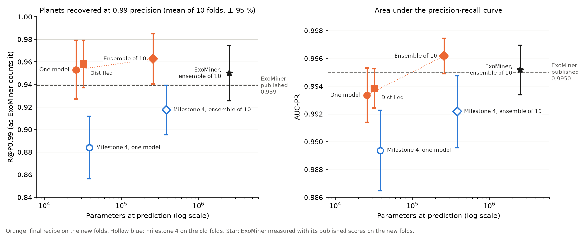
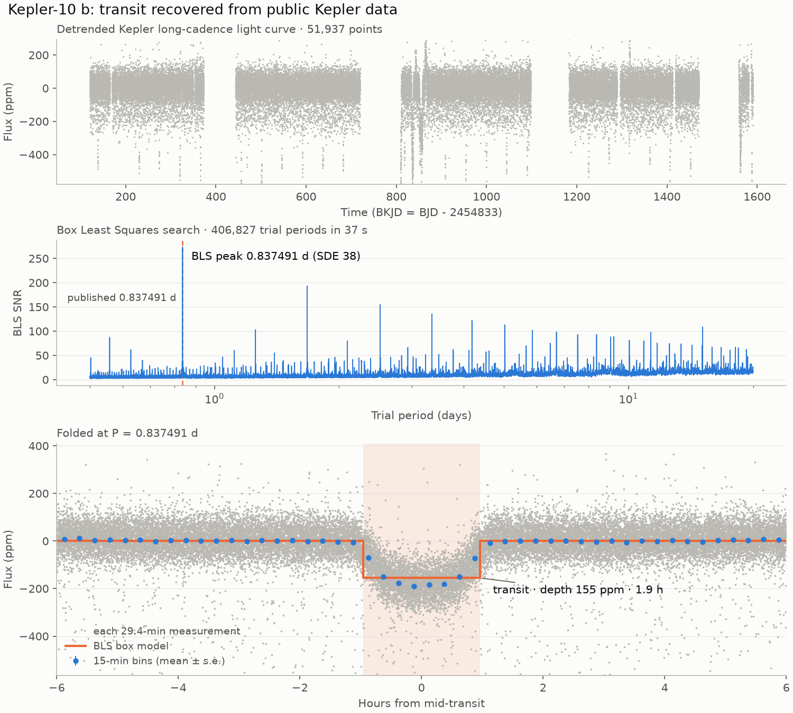

# cazaplanetas

Small, cheap neural networks that vet exoplanet transit signals in public NASA Kepler data,
measured head to head against published classifiers (Astronet, ExoMiner) on the standard
Kepler DR25 benchmark, with every number reproducible on a laptop.

*Cazaplanetas* is Spanish for "planet hunter". The code, this README and the model card are in
English; the detailed milestone reports in [`docs/`](docs/) are in Spanish.

## Result

On Kepler DR25 with ExoMiner's protocol (its labelling rules, 10-fold cross-validation split
**by star**, recall at 99 % precision and AUC-PR), the verdict rule was written down before the
final models were trained:

> the mean over the 10 folds must be **at least ExoMiner's** in recall at 99 % precision and in
> AUC-PR, both against ExoMiner's published figures and against its published per-signal scores on
> the same test folds, with fewer parameters and at most 50,000 per model; an ensemble is compared
> with ExoMiner's ensemble of ten, and a single model with that same ensemble (ExoMiner publishes
> no single models).

Mean of the 10 folds:

| | Parameters | R@P0.99 exact | R@P0.99 as ExoMiner counts it | AUC-PR |
|---|---|---|---|---|
| *ExoMiner, ensemble of 10, published (its labels and folds)* | ≈ 2.5 M | 0.920 | 0.939 | 0.995 |
| *ExoMiner, its published scores on our folds* | ≈ 2.5 M | 0.926 | 0.950 | 0.9952 |
| Pocket model, one model (mean of 10 seeds) | 25,745 | 0.927 | 0.953 | 0.9934 |
| Pocket model, the ensemble distilled into one model (mean of 10 seeds) | 25,745 | 0.936 | 0.958 | 0.9938 |
| **Pocket model, ensemble of 10** | **257,450** | **0.950** | **0.963** | **0.9962** |

- **The ensemble of ten pocket models beats ExoMiner's ensemble of ten by the rule fixed
  beforehand, with about ten times fewer parameters.** It is ahead on all three numbers, against
  the published figures (+0.030, +0.024, +0.0012) and against ExoMiner's scores on the same test
  folds (+0.023 ± 0.029, +0.013 ± 0.039, +0.0010 ± 0.0018; 95 % intervals over folds).
- **That margin is small.** The AUC-PR advantage is within the noise, and the recall advantage is at
  its edge (and, compared fold by fold on the same test folds, within the noise: +0.023 ± 0.029
  exact, +0.013 ± 0.039 ExoMiner-style). "Beats" here means "meets the rule", not "significantly better".
- **A single model does not beat it, and neither does the distilled one.** Both pass on recall at
  99 % precision but fall short on AUC-PR: −0.0016 (one model) and −0.0012 (distilled) against the
  published 0.995.
- **The test signals are not new.** The final run used a new assignment of stars to folds (seed
  20261122; every earlier step used seed 0), but the signals and labels are the same ones that were
  inspected while designing the recipe. What the new folds test is whether the advantage depended on
  how the stars happened to be grouped (it did not: the same recipe gave 0.956 · 0.969 · 0.9961 for
  the ensemble on the old folds).
- **How ExoMiner is counted.** ExoMiner's parameter count (≈ 252 k per model) was counted by hand
  from its paper. Its published 0.939 rounds precision to two decimals (precision ≥ 0.985 counts);
  0.920 is our exact count of its published scores at precision ≥ 0.99. Both counts are reported on
  both sides.
- The rule, folds and recipe were committed before training in the development history. This
  public repository is a single-commit snapshot, so that order cannot be checked here.



What made the difference (milestone 5, step 2): almost all of the gain over milestone 4 comes from
giving the network the *sibling signal*, the other signal of the same star with the same period
(typically the primary or secondary eclipse of a binary detected as a separate signal). Most of the
earlier gap to ExoMiner was in how the two numbers were compared: ExoMiner's 0.939 is a ten-model
ensemble and rounds precision.

Earlier milestones, for context: milestone 4 (the 38k-parameter model of the time against ExoMiner,
gradient-boosted trees, a retrained Astronet and the DR25 Robovetter) missed its target of
ExoMiner's quality with 50 times fewer parameters; milestone 3 built the DR25 dataset from raw light
curves and split it by star; milestone 2 retrained Astronet on its own DR24 views.

## Try it

Requires [uv](https://docs.astral.sh/uv/). Python and every dependency are pinned in `uv.lock`
(`requirements.txt` is exported from it for pip users).

```bash
git clone https://github.com/PSCactux/cazaplanetas.git
cd cazaplanetas
uv sync
uv run python scripts/demo.py                 # seconds, offline
uv run pytest -m "not network"                # offline test suite (about 2 minutes)
```

`scripts/demo.py` scores 19 DR25 signals with the published weights (`release/`): well-known
planets, the planets the ensemble scores lowest, the false positives it scores highest and a few
ordinary false positives. Each signal is scored by the ten models of the fold that never saw it
or any other signal of its star, and compared with a 99 %-precision cut chosen on that fold's
validation part. It then checks that the scores are those recorded at training time. Not every
famous planet passes: Kepler-10 b, Kepler-90 h, Kepler-186 f and Kepler-452 b fall below the cut,
which is what recall below 1 looks like.

### Recompute the verdict

```bash
uv run python scripts/hito5_veredicto.py report
git status --short    # nothing changes but the date in docs/hito5_veredicto.json
```

This reads the validation and test scores of the 200 final runs from `release/` and recomputes
every table and both figures of [`docs/hito5_veredicto.md`](docs/hito5_veredicto.md) with the same
code that measured them (under a minute). It downloads about 75 MB of public tables on the first run (the DR25 TCE and KOI
tables from the NASA Exoplanet Archive, the DR25 Robovetter output, and ExoMiner's per-signal
scores and folds from its arXiv source and its repository), into `data/` (git-ignored).

### Kepler-10 b with Box Least Squares

```bash
uv run python scripts/fetch_and_plot.py
```

Downloads the 15 long-cadence quarters of Kepler-10 from [MAST](https://archive.stsci.edu/)
(about 6 MB), removes slow trends, runs a Box Least Squares period search and writes
`docs/kepler-10b_fold.png` and `docs/kepler-10b_result.json` (only the timings change from the
committed ones): P = 0.837491 d against the published 0.8374907 d.



### Everything from scratch

The full pipeline takes hours and streams 118 GB of light curves (0.65 GB is kept). Each step is
resumable and writes its report into `docs/`:

```bash
uv run python scripts/hito2_astronet.py            # milestone 2: Astronet vs pocket model on Astronet's DR24 views (~22 min, 145 MB)
uv run python scripts/hito3_dr25.py build          # milestone 3: DR25 views from every light curve (~2 h)
uv run python scripts/hito3_dr25.py check          # compare our views with Astronet's
uv run python scripts/hito3_star_split.py          # split by star (~1 h)
uv run python scripts/hito4_dr25_cv.py run         # milestone 4: DR25 labels, 10-fold CV by star (hours)
uv run python scripts/hito4_dr25_cv.py report
uv run python scripts/hito5_diagnostico.py ablate  # milestone 5, step 1: diagnosis (hours)
uv run python scripts/hito5_diagnostico.py occlude # same inputs zeroed on the saved models (minutes)
uv run python scripts/hito5_diagnostico.py report
uv run python scripts/hito5_receta.py run --configs sib sib_mag sib_mag_em   # step 2: recipe (hours; full list in docs/hito5_receta.md)
uv run python scripts/hito5_receta.py report
uv run python scripts/hito5_veredicto.py run       # step 4: 200 final models on the new folds (hours)
uv run python scripts/hito5_veredicto.py report
uv run python scripts/export_release.py            # rewrite release/ from those runs
```

Training runs on Apple's GPU (MPS); CUDA and CPU also work. A pocket model trains in about 100 s on
an M3 Max without other load.

## How it works

- **Data.** For each of the 34,032 DR25 threshold-crossing events, `hito3_dr25.py` reads every
  Kepler long-cadence light curve of the star from MAST's public copy on AWS, in memory, checks
  its checksum, detrends it with a spline and stores folded *views*: global and local flux, odd and
  even transits, secondary eclipse and centroid motion.
- **Labels.** ExoMiner's rules: confirmed planets of the cumulative KOI table against certified
  false positives and not-transit-like signals, 31,045 labelled signals (2,724 planets).
- **No leaks.** Only 43 scalars can reach a model: the 32 DR25 TCE columns listed in
  `cazaplanetas.features.SCALAR_COLUMNS` plus 11 derived ones (sibling, Kepler magnitude and
  ephemeris-match columns, in `cazaplanetas.derived`);
  columns that give the answer away (Robovetter dispositions, `av_training_set`, KOI counts, ...) are
  rejected, and `tests/test_features.py` poisons them with the label to check that the inputs do not
  change. Folds are by star, so no star is in two of training, validation and test.
- **Model.** `models.PocketBranches`: one small separable 1-D convolutional branch per diagnostic
  test (flux, centroid, secondary/sibling), each ending in an 8-unit bottleneck, plus a scalar
  branch with 43 standardised scalars, 25,745 parameters. Thresholds and every recipe choice were
  made on validation parts only.

## Layout

```
src/cazaplanetas/   library: BLS pipeline, Astronet data, DR25 views and labels, allowed model inputs,
                    splits, models, training, diagnosis tools, ExoMiner's tables, release files
scripts/            entry points, one per milestone step, plus demo.py and export_release.py
tests/              pytest suite (-m "not network" runs offline)
release/            weights of the 100 final models, their predictions and the demo inputs (model card inside)
docs/               milestone reports (Spanish), results as JSON/CSV, figures, plan.html
data/               downloads and caches (git-ignored, created on demand)
```

## Data and credits

This repository includes data derived from observations of the Kepler mission, obtained from the
Mikulski Archive for Space Telescopes (MAST) at the Space Telescope Science Institute (STScI).
Funding for the Kepler mission is provided by the NASA Science Mission Directorate. STScI is
operated by the Association of Universities for Research in Astronomy, Inc., under NASA contract
NAS 5-26555.

This research has made use of the NASA Exoplanet Archive, which is operated by the California
Institute of Technology, under contract with the National Aeronautics and Space Administration
under the Exoplanet Exploration Program. The DR25 TCE, DR25 KOI, cumulative KOI, Kepler stellar
and certified false positive tables come from it.

- **Kepler DR25.** Thompson, S. E., et al. 2018, ApJS, 235, 38. The Robovetter's verdicts are read
  from the public output file of the DR25 Robovetter
  ([nasa/kepler-robovetter](https://github.com/nasa/kepler-robovetter)).
- **ExoMiner.** Valizadegan, H., et al. 2022, ApJ, 926, 120
  ([arXiv:2111.10009](https://arxiv.org/abs/2111.10009)). Its labelling rules and evaluation
  protocol are followed; its per-signal scores are read from the machine-readable Tables 3 and 13
  of the paper's arXiv source, and its cross-validation folds from the fold tables of
  [nasa/ExoMiner](https://github.com/nasa/ExoMiner) (commit `4baa577`). These files are downloaded
  at run time and not redistributed. **No code from ExoMiner or the Robovetter (NASA Open Source
  Agreement) is used or included**; the models here are written from the papers.
- **Astronet.** Shallue, C. J. & Vanderburg, A. 2018, AJ, 155, 94, and their
  [exoplanet-ml](https://github.com/google-research/exoplanet-ml) repository (Apache-2.0), from
  which the DR24 views and the model configuration of milestone 2 come. The PyTorch model is
  written from the paper and those configuration values; no code was copied.
- Built on [lightkurve](https://github.com/lightkurve/lightkurve),
  [astropy](https://www.astropy.org/), [PyTorch](https://pytorch.org/),
  [scikit-learn](https://scikit-learn.org/), NumPy, SciPy and Matplotlib.

## License

The code, the weights and the other files in `release/` are released under the [MIT License](LICENSE).
The Kepler data and the catalogue tables they derive from are public data from NASA's archives,
acknowledged above; ExoMiner's and Astronet's materials keep their own licences and are not
included. To cite this repository, see [`CITATION.cff`](CITATION.cff).
