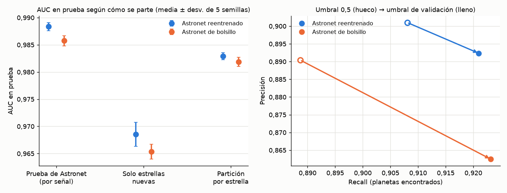

# Hito 3 · Conjunto propio de Kepler DR25, partición por estrella y umbral de validación



Tres cosas en este hito:

1. **Nuestro propio conjunto de datos de Kepler DR25**: las vistas de las 34.032 señales
   (TCE) de DR25, calculadas desde las curvas de luz originales, con todas las vistas que
   pide el [plan](plan.html#modelo) (global, local, pares, impares, eclipse secundario y
   centroide).
2. **Partición por estrella**, sin fuga: ninguna estrella tiene señales en dos partes
   distintas (entrenamiento, validación, prueba).
3. **Umbral elegido con la validación** en vez de 0,5, para el modelo de bolsillo y para
   Astronet, en las mismas condiciones.

<!-- resumen:inicio -->
**Resultado.**

* **Conjunto DR25: 34.032 de 34.032 señales procesadas (100 %)**, en 17.230 estrellas, sin
  fallos al final ([lista de fallos](hito3_fallos.csv), vacía, y [avisos](hito3_avisos.csv):
  209 señales con alguna vista casi vacía). Ocupa **652 MB** (≤ 2 GB) con un manifiesto de
  sumas SHA-256. Se leyeron 118 GB de curvas (275.127 ficheros) en 2 h 04 min **sin escribir ningún FITS en
  disco**; el disco libre medido nunca bajó de 73 GB.
* **Las vistas reproducen las de Astronet:** con las mismas efemérides y la receta de
  Astronet, la correlación de la vista global con la suya tiene **mediana 0,968 y media
  0,961** en 100 señales al azar (la local, 0,993). Y entrenadas con las mismas señales y la
  misma partición, nuestras vistas dan el mismo AUC que las suyas (0,9748 frente a 0,9756 con
  Astronet; 0,9717 frente a 0,9725 con el de bolsillo).
* **Partición por estrella:** el AUC baja de 0,9883 a **0,9829** (Astronet) y de 0,9858 a
  **0,9818** (bolsillo). Son los mismos modelos y recetas; baja porque la prueba ya no tiene
  estrellas vistas en el entrenamiento. La distancia entre los dos modelos se queda en 0,0011.
* **Umbral de validación:** el modelo de bolsillo pasa de perder 41,4 a **28,6 planetas** de
  372 (recall 0,889 → 0,923), lo mismo que Astronet con su propio umbral (29,4), a cambio de
  14 falsas alarmas más (40,8 → 54,8).
<!-- resumen:fin -->

## Cómo se reproduce

```bash
uv sync
uv run python scripts/hito3_dr25.py build    # conjunto DR25: unas 2 h con ~16 MB/s; se puede parar y retomar
uv run python scripts/hito3_dr25.py check    # 100 vistas globales nuestras frente a las de Astronet
uv run python scripts/hito3_dr25.py report   # lista de fallos, manifiesto, docs/hito3_dataset.json
uv run python scripts/hito3_star_split.py    # partición por estrella + umbral de validación (~1 h)
```

## 1. El conjunto DR25

### Cómo se construye

* **Lista de señales:** la tabla `q1_q17_dr25_tce` del NASA Exoplanet Archive (34.032
  señales en 17.230 estrellas), con todas sus columnas, en `data/dr25/`.
* **Curvas:** todas las curvas de cadencia larga (PDCSAP) de cada estrella, de la copia
  pública de MAST en AWS (`stpubdata`). Es el mismo archivo que MAST sirve por HTTP, pero
  aguanta muchas descargas en paralelo: el servidor HTTP de MAST cortaba conexiones a
  partir de unas 16 simultáneas. Cada fichero se comprueba con su MD5 (el ETag del archivo).
* **En memoria, sin FITS en disco.** El plan decía bajar por tandas y borrar los FITS al
  acabar cada tanda. Lo hemos mejorado: cada fichero se lee en memoria y se descarta en
  cuanto se han calculado las vistas de su estrella, así que **ningún FITS llega a
  escribirse** y el disco solo crece con las vistas (unos 18 MB por tanda de 500 estrellas).
  El guion para por sí solo si quedan menos de 30 GB libres.
* **Por tandas y reanudable.** 35 tandas de 500 estrellas; cada tanda se guarda en un
  `.npz` que se escribe con otro nombre y se renombra al final, de modo que una tanda o
  está entera o no está. Si se corta, al relanzar se salta las tandas hechas. Al terminar,
  las estrellas que fallaron se procesan una vez más (los fallos de red suelen ser pasajeros).
* **Limpieza de la curva:** se quitan los puntos con banderas de calidad graves (la máscara
  por defecto de lightkurve) y, por cada trimestre, la tendencia lenta con un spline
  cúbico robusto (recorte iterativo a 3σ), con los tránsitos de **todas** las señales de la
  estrella enmascarados para que el spline no se los coma. La separación entre nodos se
  elige por estrella con el criterio de información bayesiano entre 0,5 y 20 días, como
  hace Astronet (Shallue y Vanderburg 2018, sección 3).
* **Vistas** (mediana por tramo, misma geometría que Astronet):

| Vista | Tramos | Qué cubre |
|---|---|---|
| Global | 2.001 | La órbita entera, tramos de P/2001 |
| Local | 201 | ±4 duraciones del tránsito, tramos de 0,16 duraciones |
| Impares / pares | 201 + 201 | La vista local con solo los tránsitos impares o pares |
| Secundario | 201 | La vista local centrada en el eclipse secundario más fuerte que da el catálogo (`tce_maxmesd`; P/2 si falta) |
| Centroide global / local | 2.001 + 201 | Cuánto se mueve el centro de luz (segundos de arco) respecto a su tendencia |

  Se guardan en flujo relativo (0 fuera del tránsito, negativo en el tránsito), sin
  normalizar, para no perder la profundidad; `views.normalize` hace la normalización de
  Astronet (mediana 0, mínimo −1) y deja pares, impares y secundario en la escala de la vista
  local, para que se vea si un tránsito es más hondo que otro. Los tramos vacíos se rellenan
  interpolando y cada señal lleva cuántos tenía vacíos.

<!-- conjunto:inicio -->
### Qué ha salido

Datos de `uv run python scripts/hito3_dr25.py report`, que escribe
[`hito3_dataset.json`](hito3_dataset.json).

| | |
|---|---|
| Señales DR25 procesadas | **34.032 de 34.032 (100 %)**, en 17.230 estrellas |
| Fallos | 0 al final. En la primera pasada fallaron 24 señales con 0 tránsitos impares o pares sobre datos válidos (la vista impar o par quedaba vacía). Se cambió el código para guardar esas vistas como ceros y apuntar que están vacías, y la segunda pasada las procesó todas. La lista final, [`hito3_fallos.csv`](hito3_fallos.csv), está vacía. |
| Avisos | 209 señales con alguna vista de flujo con más de la mitad de los tramos vacíos, o con la vista impar o par vacía (17 y 7): [`hito3_avisos.csv`](hito3_avisos.csv). Son sobre todo periodos largos con 2–4 tránsitos. Se quedan en el conjunto; el modelo puede usar los contadores de tramos vacíos. |
| Curvas leídas | 275.127 ficheros, 118 GB, en 2 h 04 min (16 MB/s de media; el límite fue la conexión). Ninguno escrito en disco. |
| Puntos por estrella | 64.794 (mediana); 43 tránsitos con datos por señal (mediana) |
| Tamaño final | **652 MB**: 611 MB de vistas en 35 tandas `.npz`, la tabla DR25 (41 MB) y las listas de ficheros de origen con su MD5. El plan pedía ≤ 2 GB. |
| Manifiesto | `data/dr25/manifest.json`: versión, geometría de las vistas, limpieza, banderas de calidad, origen y tamaño y SHA-256 de cada fichero. Su propio SHA-256 queda en `hito3_dataset.json`. |
| Disco | Libre al empezar: 102,8 GB. Mínimo durante el trabajo: 73 GB. Lo que bajó lo usaron otros procesos del Mac: `data/` de este proyecto ocupa en total 1,6 GB (conjunto DR25 0,65 GB, vistas de Astronet 0,24 GB y pesos de los modelos de los hitos 2 y 3 0,76 GB). |

### Comparación con las vistas de Astronet

`uv run python scripts/hito3_dr25.py check` toma 100 señales al azar (semilla 0) de las
9.297 de Astronet que tienen pareja en DR25 y calcula la correlación de Pearson entre
nuestra vista global y la suya, de tres maneras:

| Cómo se calcula nuestra vista | Mediana | Media | ≥ 0,95 | Percentil 10 |
|---|---|---|---|---|
| Receta de Astronet: efemérides de DR24 (las suyas) y spline sin enmascarar tránsitos | **0,968** | **0,961** | 76 de 100 | 0,929 |
| Efemérides de DR24 y nuestra limpieza (tránsitos enmascarados) | 0,960 | 0,914 | 60 de 100 | 0,766 |
| Tal cual está en el conjunto (efemérides de DR25) | 0,449 | 0,519 | 21 de 100 | 0,062 |
| Vista **local**, receta de Astronet | 0,993 | 0,983 | 95 de 100 | 0,970 |

Cómo se lee:

* **La receta funciona.** Con las mismas efemérides y la misma manera de quitar la
  tendencia, la vista global sale casi igual que la de Astronet (mediana 0,968), y la local
  todavía más (0,993). Lo que queda deben de ser detalles del spline (Astronet tiene su
  propia implementación y su propio recorte de valores atípicos) y de las banderas de
  calidad; no lo hemos separado más. Solo 5 de las 100 quedan por debajo de 0,9.
* **Enmascarar los tránsitos es una decisión, no un error.** Astronet ajusta el spline a
  través de los tránsitos; en estrellas variables o con tránsitos largos eso se come parte
  del tránsito. Nosotros los enmascaramos. Cambia algo las vistas de estrellas variables,
  sobre todo las NTP (variabilidad estelar a la que el catálogo asignó un periodo).
* **¿Por qué baja tanto con las efemérides de DR25?** Para la mayoría de las señales, la
  vista global es sobre todo ruido: el tránsito ocupa unos pocos de los 2.001 tramos. Los
  periodos de DR24 y DR25 de una misma señal difieren en unas 6 partes por millón (mediana), y
  eso basta para que, a lo largo de cuatro años, los mismos puntos caigan en otros tramos. Las dos vistas siguen siendo correctas, pero su ruido
  ya no coincide. Por eso la prueba que importa es la de abajo: entrenar con unas vistas y con
  otras.
* **Por qué solo 9.297 de 15.737 tienen pareja.** DR25 se calculó de nuevo, con otro
  detector y otros filtros. Encuentran pareja el 99 % de los planetas candidatos (PC), el
  52 % de los falsos positivos astrofísicos (AFP) y el 28 % de los no transitorios (NTP):
  DR25 elimina más artefactos, y muchas binarias salen con el doble o la mitad del periodo.

**Ajuste del criterio del plan.** El plan pedía correlación ≥ 0,95 entre la vista global
nuestra y la suya. Tal como estaba escrito no podía cumplirse ni con dos vistas correctas
(efemérides distintas → ruido distinto). Lo hemos medido como prueba de la receta: con las
mismas efemérides y la receta de Astronet, **la mediana es 0,968 y la media 0,961, por
encima de 0,95**. No llega a 0,95 en todas: 76 de 100 lo superan y 89 superan 0,93. Como
segunda prueba, más exigente, añadimos el experimento B: entrenar con nuestras vistas
tiene que dar el mismo AUC que entrenar con las suyas, y lo da. El plan queda corregido así.
<!-- conjunto:fin -->

## 2 y 3. Partición por estrella y umbral de validación

**Partición por estrella.** `splits.split_by_star` reparte estrellas, no señales: baraja
las estrellas con una semilla fija y va dando cada una a la parte que más lejos esté de su
cuota (80/10/10 de las señales). Todas las señales de una estrella van a la misma parte, y el
guion comprueba que entrenamiento, validación y prueba no comparten ninguna estrella (también
hay una prueba automática). `splits.star_folds` da las 10 particiones por estrella que usará
la validación cruzada del hito 4.

**Umbral.** `training.choose_threshold` elige, con las probabilidades de la validación, el
umbral que da el mejor F1 (equilibrio entre precisión y recall), para cada modelo y cada
semilla. La prueba solo se usa para medir.

**Mismas condiciones.** Los dos modelos usan las mismas señales, la misma partición, las
mismas 5 semillas y las mismas recetas de entrenamiento que en el hito 2; solo cambia la
partición. El experimento A usa las 15.737 señales de Astronet con sus vistas. El B usa las
9.297 que tienen pareja en nuestro DR25 y entrena cada modelo dos veces: con las vistas de
Astronet y con las nuestras.

<!-- tabla:inicio -->
Generado por `uv run python scripts/hito3_star_split.py` el 2026-11-20 (mps, PyTorch 2.15.0). Media ± desviación de 5 semillas. Umbral de validación: el que da el mejor F1 en la validación, elegido para cada modelo y semilla.

**A. Vistas de Astronet, partición por estrella.** Entrenamiento 12.588 señales (7.865 estrellas), validación 1.574, prueba 1.575 señales de 1.006 estrellas (372 planetas). Ninguna estrella está en dos partes.

| Modelo | AUC | AUC-PR | Umbral | Precisión | Recall | Planetas perdidos | Falsas alarmas | Parámetros | Entrenamiento | Inferencia (MPS · CPU 1 hilo) |
|---|---|---|---|---|---|---|---|---|---|---|
| Astronet reentrenado | 0,9829 ± 0,0007 | 0,955 ± 0,003 | 0,5 | 0,901 ± 0,021 | 0,908 ± 0,019 | 34,2 ± 7,1 | 37,4 ± 9,4 | 9.940.193 | 345 ± 142 s | 78 µs · 2,40 ms |
|  |  |  | 0,44 ± 0,16 | 0,892 ± 0,020 | 0,921 ± 0,018 | 29,4 ± 6,7 | 41,6 ± 9,0 |  |  |  |
| Astronet de bolsillo | 0,9818 ± 0,0008 | 0,951 ± 0,003 | 0,5 | 0,890 ± 0,011 | 0,889 ± 0,016 | 41,4 ± 5,8 | 40,8 ± 5,4 | 36.161 | 149 ± 8 s | 52 µs · 1,96 ms |
|  |  |  | 0,35 ± 0,08 | 0,862 ± 0,007 | 0,923 ± 0,011 | 28,6 ± 4,2 | 54,8 ± 3,8 |  |  |  |
| Astronet reentrenado, media de 5 | 0,9838 | 0,959 | 0,39 | 0,901 | 0,930 | 26 | 38 | 49.700.965 | — | — |
| Astronet de bolsillo, media de 5 | 0,9838 | 0,957 | 0,29 | 0,842 | 0,944 | 21 | 66 | 180.805 | — | — |

Las mismas recetas con la partición por señal de Astronet (hito 2), para comparar:

| Modelo | Prueba de Astronet (1.574 señales) | Solo sus 690 señales de estrellas nuevas | Partición por estrella (esta) |
|---|---|---|---|
| Astronet reentrenado | 0,9883 ± 0,0007 | 0,9685 ± 0,0022 | 0,9829 ± 0,0007 |
| Astronet de bolsillo | 0,9858 ± 0,0009 | 0,9653 ± 0,0014 | 0,9818 ± 0,0008 |

**B. Vistas propias frente a vistas de Astronet**, mismas 9.297 señales (las de DR24 con pareja en nuestro DR25), misma partición por estrella (prueba: 930 señales, 350 planetas). Solo cambia quién hizo las vistas.

| Modelo | Vistas | AUC | AUC-PR | Precisión (umbral de validación) | Recall (umbral de validación) |
|---|---|---|---|---|---|
| Astronet reentrenado | de Astronet | 0,9756 ± 0,0010 | 0,949 ± 0,002 | 0,888 ± 0,007 | 0,898 ± 0,005 |
| Astronet reentrenado | propias (DR25) | 0,9748 ± 0,0013 | 0,950 ± 0,003 | 0,889 ± 0,010 | 0,898 ± 0,014 |
| Astronet de bolsillo | de Astronet | 0,9725 ± 0,0016 | 0,946 ± 0,005 | 0,884 ± 0,019 | 0,881 ± 0,032 |
| Astronet de bolsillo | propias (DR25) | 0,9717 ± 0,0015 | 0,942 ± 0,004 | 0,885 ± 0,014 | 0,899 ± 0,029 |

<!-- tabla:fin -->

Notas sobre las columnas:

* **Planetas perdidos y falsas alarmas:** de los 372 planetas de la prueba y de sus 1.203
  señales que no son planetas.
* **Entrenamiento:** la máquina no estaba libre: durante el experimento A corrían a la vez la
  descarga de DR25 y otros trabajos (carga media de 15 a 30). Por eso los tiempos son de 2 a
  3 veces los del hito 2 y varían mucho. Para comparar costes valen los del
  [hito 2](hito2.md) (197 s frente a 57 s, máquina sin otra carga). En el experimento B, con menos
  carga, la proporción se mantiene: 112–128 s para Astronet y 28–33 s para el de bolsillo, con
  7.437 señales.
* **Inferencia:** en la CPU, con un solo hilo y de una en una, como en el hito 2. También está
  medida con la máquina cargada.
* **Exhaustividad con precisión 0,99** (en `hito3_results.json`): 0,31 para Astronet y 0,36
  para el de bolsillo con la partición por estrella. En el hito 2 era ~5 %. Con tan pocos
  planetas de prueba, esta métrica depende de unas pocas señales con nota muy alta; la
  retomaremos en DR25 con validación cruzada (hito 4).

## Por qué las cifras bajan sin que el modelo sea peor

Con la partición de Astronet, el 56 % de las señales de prueba (884 de 1.574) están en
estrellas que también tienen señales en entrenamiento. El 76 % de esas 884 son falsos
positivos astrofísicos: casi siempre binarias cuyo eclipse primario y secundario salen como
dos señales, una en entrenamiento y otra en prueba. Reconocer la «misma» binaria es fácil y
sube el AUC. Al partir por estrella eso desaparece, y el AUC baja unas 0,005 en los dos
modelos (0,9883 → 0,9829 y 0,9858 → 0,9818). Los modelos, las recetas y las semillas son los
mismos; lo que cambia es que la prueba ya no premia la memoria. Las cifras de los hitos 3 en
adelante salen, por tanto, más bajas que las publicadas por Astronet, y son las honestas.

¿Y el 0,968 del hito 2? Allí, para estimar el efecto, nos quedamos con las 690 señales de
prueba cuya estrella no estaba en entrenamiento. Pero ese subconjunto **no es una muestra
representativa**: deja fuera todas las estrellas con varias señales (sistemas con varios
planetas, que son fáciles, y binarias con dos señales). Tiene más NTP (25 % frente a 16 %) y
menos AFP (43 % frente a 62 %). Por eso salía más bajo de lo justo. Una partición por estrella
de verdad mete estrellas enteras en la prueba, con todas sus señales, y da 0,983.

## El umbral de validación recupera el recall del modelo pequeño

Con el umbral 0,5, el modelo de bolsillo perdía más planetas que Astronet (41,4 frente a
34,2 de 372 con la partición por estrella; en el hito 2, unos 16 más de 360). Su umbral
elegido en validación es más bajo (0,35 ± 0,08). Con él pierde **28,6 planetas**, lo mismo
que Astronet con su propio umbral (29,4), a cambio de unas 14 falsas alarmas más (54,8
frente a 41,6). La exactitud apenas cambia (0,948 → 0,947). La media de los 5 modelos pequeños
(180.805 parámetros, 55 veces menos que un solo Astronet) llega a perder solo 21 planetas,
con 66 falsas alarmas. El umbral se elige con la validación, nunca con la prueba, así que
estas cifras no están ajustadas a la prueba.

Para la criba de candidatos, perder menos planetas a cambio de revisar unas pocas señales
más suele compensar. Si se prefiere otra operación (por ejemplo, precisión 0,99 como
ExoMiner), basta con otro criterio en `choose_threshold`; el modelo es el mismo.

## Para el hito 4

* El conjunto DR25 ya tiene todas las vistas; faltan las **etiquetas DR25** (catálogo KOI
  acumulado, falsos positivos certificados y veredicto del Robovetter) y los **escalares**,
  con una lista explícita de columnas permitidas. La tabla DR25 tiene columnas que no se
  pueden usar como entrada (`av_training_set`, `av_pred_class`…).
* Validación cruzada por estrella con `splits.star_folds` (10 particiones), como ExoMiner.
* El modelo de bolsillo tiene que aprender a usar pares/impares, secundario y centroide;
  deberían separar mejor las binarias, que son la mayor parte de los errores.

## Fuentes

* Thompson, S. E. y otros (2018). *Planetary Candidates Observed by Kepler. VIII. A Fully
  Automated Catalog with Measured Completeness and Reliability Based on Data Release 25*.
  ApJS 235, 38. [arXiv:1710.06758](https://arxiv.org/abs/1710.06758). Tabla DR25 de TCE.
* Shallue, C. J. y Vanderburg, A. (2018). AJ 155, 94. [arXiv:1712.05044](https://arxiv.org/abs/1712.05044).
  Sección 3: limpieza con spline elegido por BIC y geometría de las vistas global y local.
* Datos de Kepler: MAST (STScI), copia pública en AWS Open Data (`stpubdata`). Tablas DR24 y
  DR25: NASA Exoplanet Archive (Caltech/IPAC).
