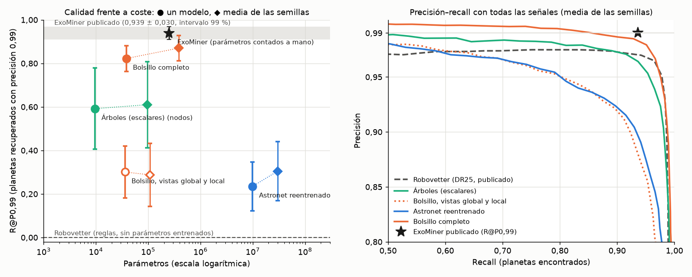

# Hito 4 · El modelo de bolsillo frente a ExoMiner, el Robovetter y Astronet en Kepler DR25



<!-- resumen:inicio -->
**Resultado: el criterio no se cumple, y se publican la curva calidad–coste y las
distancias exactas, como prevé el plan.** Con el protocolo de ExoMiner (validación cruzada
por estrella en 10 particiones, 10 semillas), el modelo de bolsillo completo, de 38.441
parámetros, recupera con precisión 0,99 el **82,2 % ± 5,9 %** de los planetas con un solo
modelo y el **87,0 % ± 5,8 %** con la media de 10. ExoMiner publica el 93,9 % ± 3,0 %. El
AUC-PR del modelo pequeño es 0,989 (0,992 con la media) frente a 0,995. Tiene **6,6 veces menos parámetros que
ExoMiner** (unos 252.600, contados a mano de su artículo), no 50, y **259 veces menos que
Astronet**. Cada modelo entrena en menos de 10 minutos en un Mac con M3 Max.

Frente a los demás modelos del mismo protocolo, el modelo de bolsillo completo es, con
diferencia, el mejor: Astronet reentrenado se queda en un 23,5 %, los árboles con los
escalares en un 59,2 % y el Robovetter en un 0 %.
<!-- resumen:fin -->

## Cómo se reproduce

```bash
uv sync
uv run python scripts/hito3_dr25.py build       # conjunto DR25 del hito 3 (si no está ya)
uv run python scripts/hito4_dr25_cv.py run      # etiquetas + 10 particiones; se puede parar y retomar
uv run python scripts/hito4_dr25_cv.py report   # tablas de este documento, hito4_results.json y la figura
uv run python scripts/hito4_dr25_cv.py run --quick   # prueba de humo: 2 particiones, 1 semilla, 1 época
```

`run` acepta `--models`, `--seeds`, `--astronet-seeds` y `--reverse` (particiones de la
última a la primera) para repartir el trabajo (por ejemplo, Astronet en un proceso y el
modelo de bolsillo en otro). Cada combinación de modelo, partición y semilla guarda sus
predicciones en `data/hito4/preds/`; si se corta, al relanzar solo hace lo que falta.

## 1. Etiquetas DR25

`cazaplanetas.labels` baja cuatro tablas públicas y aplica las reglas de ExoMiner
(Valizadegan y otros 2022, sección 4.1):

| Tabla | De dónde | Para qué |
|---|---|---|
| KOI acumulado (`cumulative`) | NASA Exoplanet Archive, TAP | Disposición actual de cada KOI: confirmado, candidato o falso positivo |
| KOI de DR25 (`q1_q17_dr25_koi`) | NASA Exoplanet Archive, TAP | Qué señal DR25 (estrella + número) es cada KOI |
| Falsos positivos certificados (FPWG) | NASA Exoplanet Archive, visor de tablas (no está en TAP) | `CERTIFIED FP` y `CERTIFIED FA`, revisados a mano |
| Salida del Robovetter de DR25 | `kplr_dr25_obs_robovetter_output.txt` del repositorio público del Robovetter | Su nota y su veredicto PC/FP para cada señal: **solo como competidor** |

Reglas:

* **PC (planeta):** la señal es un KOI **confirmado** en el KOI acumulado. Los candidatos
  sin confirmar no se usan.
* **AFP (falso positivo astrofísico):** el KOI está como `CERTIFIED FP` en la tabla FPWG.
* **NTP (no transitorio):** la señal nunca llegó a KOI (el Robovetter la vio «no parecida a
  un tránsito») o el KOI está como `CERTIFIED FA` (falsa alarma).
* Se quitan los 1.498 TCE «rogue» (`tce_rogue_flag = 1`: señales de tres tránsitos que
  salieron por un fallo del pipeline). Todo lo demás (candidatos, falsos positivos sin
  certificar) queda **sin etiqueta** y no entra ni en el entrenamiento ni en la medida.
* Un caso que ExoMiner no aclara: 7 KOI están **confirmados y a la vez** certificados como
  falsos positivos. Los dejamos sin etiqueta, sin elegir bando.

Las cuentas salen casi iguales a las de ExoMiner (tabla de abajo). La diferencia está en los
planetas: **2.724 confirmados frente a 2.291**, porque ExoMiner bajó el KOI acumulado en
febrero de 2020 y desde entonces se han confirmado unos 430 más. Entre ellos están los 301
que validó el propio ExoMiner. Eso no es una fuga: la etiqueta de un planeta validado no
entra como dato. Pero sí hace nuestro conjunto algo distinto del suyo, y tiene más planetas
difíciles (los de los últimos años se confirmaron justo porque eran dudosos).

## 2. Qué puede entrar al modelo y qué no

La tabla DR25 de TCE tiene 158 columnas. `cazaplanetas.features` fija **una lista explícita
de 32 columnas permitidas** (`SCALAR_COLUMNS`) y una lista de patrones **prohibidos**
(`FORBIDDEN_PATTERNS`). `features.scalar_matrix` solo lee las columnas de la lista, después
de comprobar con `assert_allowed` que ninguna está prohibida; el guion vuelve a comprobarlo
al arrancar y guarda la lista exacta en `hito4_results.json`.

**Prohibidas** (con el motivo):

| Columnas | Por qué |
|---|---|
| `av_training_set`, `av_pred_class` y todas las `av_*` | Etiquetas de entrenamiento y predicciones del Autovetter. En DR25 están vacías, en DR24 llenas. |
| `tce_nkoi` | Número de KOI ligados a la señal. **Las 20.641 señales con etiqueta que tienen `tce_nkoi = 0` (el 66 %) son todas NTP**, por construcción; entre las demás, el 26 % son planetas. Es la fuga más peligrosa de la tabla, porque no lleva «disposition» en el nombre. |
| `tce_*_prov`, `tce_steff_err`, `tce_slogg_err`, `tce_smet_err`, `tce_sradius_err` | De dónde salen los parámetros de la estrella y su error. La espectroscopía de seguimiento se hizo sobre todo en estrellas con candidatos, así que la procedencia «espectroscópica» y los errores pequeños delatan la etiqueta. |
| `tce_rogue_flag` | Se usa para quitar los TCE rogue. |
| `kepid`, `tce_plnt_num`, `ra`, `dec` | Identificadores: con ellos el modelo puede reconocer la estrella. |
| `tce_delivname`, `tce_datalink_*`, `rowupdate` | Administración de la tabla. |
| Cualquier `koi_*`, `fpwg_*`, `robovetter*`, o cualquier columna con `disp`, `score`, `training_set`, `pred_class` o `label` | Son las etiquetas, o la respuesta del competidor. |

**Permitidas:** diagnósticos del pipeline (DV) que se calculan sin conocer la disposición:

| Grupo | Columnas |
|---|---|
| Ajuste del tránsito | `tce_period`, `tce_duration`, `tce_depth`, `tce_prad`, `tce_ror`, `tce_impact`, `tce_dor`, `tce_model_snr`, `tce_max_mult_ev`, `tce_max_sngle_ev`, `tce_num_transits`, `tce_chisq1`, `tce_chisq2` |
| Eclipse secundario | `tce_maxmes`, `wst_robstat`, `wst_depth`, `tce_albedo_stat`, `tce_ptemp_stat` |
| Pares frente a impares | `tce_bin_oedp_stat` |
| Centroide | `tce_fwm_stat`, `tce_dikco_msky`, `tce_dikco_msky_err`, `tce_dicco_msky`, `tce_dicco_msky_err` |
| Otros diagnósticos DV | `boot_fap` (probabilidad de falsa alarma por bootstrap), `tce_cap_stat` y `tce_hap_stat` (reflejos ópticos), `tce_rb_tcount0` (banda rodante) |
| Estrella | `tce_steff`, `tce_slogg`, `tce_smet`, `tce_sradius` |

Cada columna lleva su transformación (logaritmo, logaritmo con signo o −log₁₀ de la
probabilidad) y se estandariza con la mediana y el rango intercuartílico **de la parte de
entrenamiento de cada partición**. Las vistas permitidas son las siete del hito 3 (global,
local, impares, pares, secundario y las dos de centroide); las de centroide se dividen por
su propia dispersión para que se lean como «cuántas sigmas se mueve el centro de luz».

**La prueba automática** (`tests/test_features.py`): (1) las 27 columnas que delatan la
respuesta (incluidas `av_training_set`, `av_pred_class` y `tce_nkoi`) están prohibidas, y
pedirlas da error; (2) ninguna columna permitida casa con un patrón prohibido; (3) una
tabla falsa en la que las columnas prohibidas **son** la etiqueta da exactamente las mismas
entradas si esas columnas se invierten o se quitan; (4) las entradas de cada modelo
(`INPUTS` y los argumentos de `forward`) son solo vistas permitidas y los escalares de la
lista.

## 3. Protocolo

* **Validación cruzada por estrella**, como ExoMiner: `splits.star_folds` reparte las
  estrellas en 10 particiones. En la partición *f*, la prueba es la parte *f*, la
  validación la *f*+1 y las otras 8 entrenan. Ninguna estrella está en dos partes (el guion
  lo comprueba en cada partición).
* **Mismas condiciones para todos:** las mismas señales, etiquetas y particiones; el umbral
  se elige en la validación (mejor F1) para cada modelo, partición y semilla; la prueba
  solo mide.
* **Semillas:** 10 por partición para el modelo de bolsillo completo y los árboles (100
  modelos cada uno, lo que pide el criterio); 3 para Astronet y para el bolsillo con solo
  global y local (ver «Coste» abajo).
* **Intervalos:** primero se promedia cada métrica sobre las semillas de cada partición, y
  luego se da la media de las 10 particiones ± el intervalo del 95 % (t de Student, 9 grados
  de libertad). ExoMiner da el intervalo del **99 %**: el nuestro es más estrecho por
  construcción, a igualdad de dispersión.
* **Dos formas de dar el resultado**, como ExoMiner: la media sobre particiones, y «todas
  las señales a la vez» (cada señal puntuada por los modelos de la partición en la que
  estaba en prueba; es la cifra principal de su artículo, 93,6 %).

**Modelos:**

| Modelo | Entradas | Receta |
|---|---|---|
| Robovetter | Su propia salida publicada (nota y veredicto) | No se entrena. Ojo: sus reglas se ajustaron conociendo estas etiquetas, así que sale favorecido (lo dice también ExoMiner). Su nota tiene muchos empates en 1,0, y por eso no llega nunca a precisión 0,99. |
| Árboles | Las 32 columnas permitidas | `HistGradientBoostingClassifier` de scikit-learn, número de rondas elegido con la validación (AUC-PR) |
| Bolsillo, global y local | Vistas global y local | El modelo de 36.161 parámetros de los hitos 2 y 3 |
| **Bolsillo completo** | Las 7 vistas y las 32 columnas | 38.441 parámetros: rama global (flujo + centroide), rama local (tránsito, impares, pares, secundario, centroide) y rama de escalares |
| Astronet reentrenado | Vistas global y local | 9.940.193 parámetros, receta del artículo (50 épocas) |

Las dos versiones del modelo de bolsillo usan la receta del hito 3 (20 épocas, AdamW, coseno).
El único cambio: la época se elige con el AUC-PR de la validación en vez de con el AUC,
porque aquí solo el 9 % de las señales son planetas y lo que se mide es la parte alta de la
curva precisión–recall. Astronet usa la última época, como en su artículo.

## 4. Resultados

<!-- tabla:inicio -->
Generado por `uv run python scripts/hito4_dr25_cv.py run && uv run python scripts/hito4_dr25_cv.py report` el 2026-11-20 (mps, PyTorch 2.15.0, scikit-learn 1.9.1). Validación cruzada por estrella en 10 particiones: 31.045 señales con etiqueta (2.724 planetas) en 15.667 estrellas. «± » es el intervalo del 95 % (t de Student) sobre las 10 particiones.

**Etiquetas** (reglas de ExoMiner con las tablas del archivo de hoy):

| Clase | Nosotros | ExoMiner (2022) |
|---|---|---|
| PC (planeta confirmado) | 2.724 | 2.291 |
| AFP (falso positivo certificado) | 3.539 | 3.538 |
| NTP (no transitorio) | 24.782 | 24.779 |
| Total con etiqueta | 31.045 | 30.609 |
| Sin etiqueta (candidatos sin confirmar y casos dudosos) | 1.489 | — |
| TCE «rogue» quitados | 1.498 | 1.498 |

**Calidad.** Modelo único: media de las semillas en cada partición, y media ± intervalo sobre las particiones. Precisión y recall con el umbral elegido en la validación (mejor F1).

| Modelo | Semillas × particiones | AUC-PR | R@P0,99 | AUC | Precisión | Recall |
|---|---|---|---|---|---|---|
| Robovetter (DR25, publicado) | — | 0,962 ± 0,008 | 0,000 ± 0,000 | 0,9933 ± 0,0023 | 0,953 ± 0,007 | 0,980 ± 0,006 |
| Árboles (escalares) | 10 × 10 | 0,984 ± 0,005 | 0,592 ± 0,187 | 0,9984 ± 0,0006 | 0,947 ± 0,010 | 0,956 ± 0,011 |
| Árboles (escalares), media de 10 | — | 0,984 ± 0,005 | 0,610 ± 0,197 | 0,9985 ± 0,0006 | 0,946 ± 0,013 | 0,956 ± 0,014 |
| Bolsillo completo | 10 × 10 | 0,989 ± 0,003 | 0,822 ± 0,059 | 0,9981 ± 0,0011 | 0,961 ± 0,004 | 0,959 ± 0,009 |
| Bolsillo completo, media de 10 | — | 0,992 ± 0,003 | 0,870 ± 0,058 | 0,9983 ± 0,0011 | 0,969 ± 0,009 | 0,966 ± 0,010 |
| Bolsillo, vistas global y local | 3 × 10 | 0,954 ± 0,007 | 0,301 ± 0,120 | 0,9948 ± 0,0010 | 0,892 ± 0,013 | 0,906 ± 0,013 |
| Bolsillo, vistas global y local, media de 3 | — | 0,959 ± 0,007 | 0,288 ± 0,145 | 0,9956 ± 0,0009 | 0,902 ± 0,019 | 0,908 ± 0,028 |
| Astronet reentrenado | 3 × 10 | 0,957 ± 0,008 | 0,235 ± 0,112 | 0,9952 ± 0,0015 | 0,893 ± 0,012 | 0,929 ± 0,012 |
| Astronet reentrenado, media de 3 | — | 0,961 ± 0,007 | 0,304 ± 0,135 | 0,9955 ± 0,0015 | 0,898 ± 0,015 | 0,932 ± 0,014 |
| *ExoMiner (publicado, media de 10 por partición)* | 10 × 10 | *0,995 ± 0,002* | *0,939 ± 0,030* | *1,000* | *0,968* | *0,974* |
| *Robovetter según ExoMiner* | — | *0,958 ± 0,019* | *0,364 ± 0,484* | *0,994* | *0,950* | *0,975* |
| *Astronet según ExoMiner* | 10 × 10 | *0,927 ± 0,014* | *0,198 ± 0,174* | *0,993* | *0,862* | *0,885* |

Las filas en cursiva son las cifras publicadas por Valizadegan y otros (2022, tablas 4 y 5): media sobre las 10 particiones ± intervalo del **99 %**, con umbral 0,5.

**Todas las señales a la vez** (como la cifra principal de ExoMiner: cada señal puntuada por los modelos de la partición en la que estaba en prueba; media de las semillas):

| Modelo | AUC-PR | R@P0,99 | Precisión | Recall | Planetas perdidos | Falsas alarmas (AFP + NTP) |
|---|---|---|---|---|---|---|
| Robovetter (DR25, publicado) | 0,962 | 0,000 | 0,954 | 0,980 | 55 de 2.724 | 118 + 12 |
| Árboles (escalares) | 0,978 | 0,356 | 0,945 | 0,957 | 118 de 2.724 | 42 + 109 |
| Bolsillo completo | 0,991 | 0,857 | 0,969 | 0,966 | 93 de 2.724 | 39 + 44 |
| Bolsillo, vistas global y local | 0,959 | 0,257 | 0,900 | 0,908 | 250 de 2.724 | 235 + 39 |
| Astronet reentrenado | 0,960 | 0,222 | 0,898 | 0,932 | 185 de 2.724 | 259 + 30 |
| *ExoMiner (publicado)* | *0,995* | *0,936* | *0,968* | *0,974* | — | — |

**Coste.** Entrenamiento: media por modelo en un Mac con M3 Max (14 núcleos) que tenía otros trabajos en marcha (carga media indicada). Inferencia: por señal, en MPS por lotes de 1.024 y en CPU con un hilo y de una en una.

| Modelo | Parámetros | Multiplicaciones-sumas por señal | Entrenamiento | Carga media | Inferencia (MPS · CPU 1 hilo) |
|---|---|---|---|---|---|
| Árboles (escalares) | 9.638 nodos | — | 10 ± 4 s (máx. 30 s) | 16 | — |
| Bolsillo, vistas global y local | 36.161 | 9.036.544 | 422 ± 96 s (máx. 544 s) | 10 | 70 µs · 1,85 ms |
| Bolsillo completo | 38.441 | 9.150.792 | 363 ± 132 s (máx. 569 s) | 21 | 62 µs · 1,87 ms |
| Astronet reentrenado | 9.940.193 | 126.308.896 | 818 ± 279 s (máx. 1270 s) | 16 | 71 µs · 2,52 ms |
| *ExoMiner (contados a mano de su artículo)* | *≈ 252.647* (*252.193–268.519*) | — | — | — | — |

**Criterio del hito 4:** R@P0,99 del modelo de bolsillo completo = 0,822 ± 0,059 (un modelo) y 0,870 ± 0,058 (media de 10), frente al intervalo publicado de ExoMiner 0,909–0,969 (0,939 ± 0,030): por debajo; la distancia a la media de ExoMiner es 0,117 en R@P0,99 y 0,006 en AUC-PR. Parámetros: 38.441, 6,6 veces menos que ExoMiner (≈ 252.647, contados a mano de su artículo) y 259 veces menos que Astronet: no llega a las 50 veces frente a ExoMiner. Entrenamiento más largo: 9,5 min (menos de 10). **No se cumple** (calidad, parámetros); se publican la curva calidad–coste y las distancias.

<!-- tabla:fin -->

<!-- lectura:inicio -->
## 5. Qué dicen los números

**Criterio.** La tabla pide tres cosas, y se cumple una:

| Condición | Pedido | Medido | ¿Se cumple? |
|---|---|---|---|
| R@P0,99 dentro del intervalo publicado de ExoMiner o por encima | ≥ 0,909 (0,939 − 0,030) | 0,822 ± 0,059 con un modelo; 0,870 ± 0,058 con la media de 10 | No: faltan 0,087 (un modelo) y 0,039 (media de 10) hasta el borde del intervalo, y 0,117 y 0,069 hasta su media |
| Parámetros | ≥ 50 veces menos que ExoMiner | 6,6 veces menos que ExoMiner (259 frente a Astronet) | No |
| Entrenamiento | < 10 min por modelo | 6,1 min de media y 9,5 min el más lento, con otros trabajos en marcha (carga media 21); sin otra carga, unos 100 s | Sí |

**La distancia exacta con ExoMiner:** 0,006 en AUC-PR (0,003 con la media de 10) y 0,117 en
R@P0,99 (0,069 con la media de 10). Con «todas las señales a la vez», la cifra principal de
su artículo, la media de 10 da 0,857 frente a 0,936. Con el umbral de validación, la media de
10 iguala su precisión (0,969 frente a 0,968) y se queda algo por debajo en recall (0,966
frente a 0,974). La distancia está casi entera en la parte más exigente de la curva: con
precisión 0,99 se tolera una falsa alarma por cada 99 planetas.

**Qué hace falta para acercarse.** En la figura, la media de 10 modelos de bolsillo
(384.000 parámetros en total) ya tiene más parámetros que un solo ExoMiner y sigue por
debajo de su intervalo. Así que, con estos datos, el modelo pequeño no compra la calidad de
ExoMiner solo con más copias. Lo que más pesa es la información que recibe: con solo las
vistas global y local, el mismo modelo se queda en un 30 %; con las siete vistas y las 32
columnas, sube a un 82 %. Este hito no separa cuánto aportan las vistas nuevas y cuánto los
escalares (los árboles, solo con escalares, llegan a un 59 %); es la primera prueba que
haría falta antes de cambiar el modelo.

**Por qué la comparación con ExoMiner no es exacta**, en las dos direcciones:

* **Etiquetas.** Tenemos 2.724 planetas frente a sus 2.291: unos 430 confirmados desde 2020,
  en buena parte señales que costó confirmar (incluidos los 301 que validó el propio
  ExoMiner). Es de esperar que eso haga nuestro conjunto algo más difícil en la zona de
  precisión alta, aunque aquí no está medido. Las cuentas de AFP y NTP coinciden casi
  exactas. (Medido en el [diagnóstico del hito 5](hito5_diagnostico.md): es al revés. Con las
  etiquetas de 2020 de ExoMiner, la media de 10 baja de 0,870 a 0,829. Y la cifra de ExoMiner es
  la media de 10 modelos por partición, con una cuenta de la precisión más laxa que la nuestra.)
* **Ruido de la métrica.** Cada partición tiene unos 270 planetas, y con precisión 0,99 dos o
  tres falsas alarmas mueven el resultado. Para un mismo modelo, el R@P0,99 va de 0,65 a 0,90
  según la partición (de 0,70 a 0,96 con la media de 10). Su intervalo del 95 % (± 0,06) es
  el doble que el del 99 % de ExoMiner (± 0,03).
* **Intervalos.** ExoMiner da el intervalo del 99 %; nosotros el del 95 %. No cambia la
  conclusión: con el del 99 % (± 0,085 con un modelo), el 0,822 llega hasta 0,907, todavía por debajo
  de 0,909.

**Lo que sí sale bien:**

* El modelo de bolsillo completo deja atrás a Astronet reentrenado en todas las particiones,
  con 259 veces menos parámetros y menos de la mitad de tiempo de entrenamiento: 0,822 frente a 0,235
  en R@P0,99, y 0,989 frente a 0,957 en AUC-PR.
* Nuestro Astronet reentrenado sale como el que publica ExoMiner (0,235 ± 0,112 frente a
  0,198 ± 0,174 en R@P0,99; 0,957 frente a 0,927 en AUC-PR). Esa coincidencia sugiere que el
  protocolo y las etiquetas son comparables.
* El bolsillo con solo las vistas global y local empata con Astronet (0,301 frente a 0,235,
  dentro del ruido) con 275 veces menos parámetros. Es lo mismo que salió en los hitos 2 y 3.
* El Robovetter da 0 en R@P0,99 porque su nota vale 1,0 en 1.510 de las señales con
  etiqueta (con 1.466 planetas), y entre ellas el 2,9 % son falsos positivos: ni su grupo
  de arriba llega a precisión 0,99. ExoMiner publica 0,364 ± 0,484 para él, con un
  intervalo que va de 0 a 0,85: con ese empate, el resultado depende de cómo se ordenen las
  señales empatadas.

**Coste.** Los tiempos se midieron con otros trabajos en marcha en la misma máquina (carga media
entre 10 y 21 en 14 núcleos) y con dos o tres entrenamientos a la vez en la misma GPU. Por
eso valen como cota superior. Las últimas particiones, casi sin otra carga, tardaron unos
100 s por modelo. La predicción cuesta lo mismo en los tres modelos de red en MPS (60–70 µs
por señal en lotes); en CPU, de una en una, el modelo de bolsillo tarda 1,9 ms y Astronet
2,5 ms.
<!-- lectura:fin -->

## 6. Cuántos parámetros tiene ExoMiner

Su artículo no lo dice. Los hemos contado a mano, capa por capa, con la arquitectura
ajustada que da su figura 9 (sección 3.6) y la clase del modelo en el repositorio público
de esa época (`CNN1dPlanetFinderv2`, commit `551bb1f` de `nasa/ExoMiner`; solo leído, no
copiado ni ejecutado): convoluciones de núcleo 6 con 16, 32 y 64 filtros, vistas de 301 y
31 puntos, una capa de 4 neuronas al final de cada rama, 4 capas de 128, PReLU y sin
normalización por lotes.

| Parte | Parámetros |
|---|---|
| Rama de flujo de la órbita entera | 87.256 |
| Rama de centroide de la órbita entera | 87.256 |
| Ramas del tránsito: flujo, centroide, impares/pares, secundario | 5.915 + 5.931 + 5.957 + 5.927 |
| Bloque final (4 × 128 y salida) | 54.405 |
| **Total** | **252.647** |

El intervalo va de 252.193 a 268.519 según el relleno de las capas de agrupación y según
si se cuentan dos capas pequeñas para los escalares de la estrella y del pipeline, que el
código añadió después del artículo. Casi el 70 % está en las dos ramas de la órbita entera,
que aplanan 280 × 64 valores antes de su capa de 4 neuronas. El ExoMiner++ actual del
repositorio es otro modelo (1.424.003 parámetros, según su documentación).

## Lo que queda para más adelante

* **Completitud y fiabilidad con señales simuladas** (tránsitos inyectados, curvas
  invertidas y barajadas). El plan lo ponía en este hito, pero pide otro conjunto de vistas:
  las señales simuladas de DR25 se encontraron en curvas *modificadas* (invertidas,
  barajadas por trimestres o con tránsitos inyectados), así que habría que volver a leer las
  118 GB de curvas originales para invertirlas y barajarlas, y bajar las curvas con
  inyecciones, que son aparte. Las listas de esas señales y el veredicto del Robovetter sobre
  ellas ya están localizados (los mismos ficheros públicos del Robovetter). Lo dejamos como
  paso propio, antes de TESS (apuntado al principio del hito 5 en el plan).
* Confirmar el número de parámetros de ExoMiner **ejecutando** su código (en la sección 6
  están contados a mano). Haría falta TensorFlow y su configuración ajustada, que no está en el
  repositorio público.

## Fuentes

* Repositorio público de ExoMiner, `nasa/ExoMiner` (licencia NOSA), commit `551bb1f`:
  leído para contar los parámetros, sin copiar ni ejecutar su código.
* Valizadegan, H. y otros (2022). *ExoMiner: A Highly Accurate and Explainable Deep Learning
  Classifier That Validates 301 New Exoplanets*. ApJ 926, 120.
  [arXiv:2111.10009](https://arxiv.org/abs/2111.10009). Sección 4.1 (etiquetas), 4.2
  (protocolo), tablas 4 y 5 (resultados de ExoMiner, Robovetter y Astronet), figura 9 y
  sección 3.6 (arquitectura ajustada).
* Thompson, S. E. y otros (2018). ApJS 235, 38. [arXiv:1710.06758](https://arxiv.org/abs/1710.06758).
  Catálogo DR25 y Robovetter; salida pública del Robovetter de DR25 (repositorio
  `nasa/kepler-robovetter`).
* Shallue, C. J. y Vanderburg, A. (2018). AJ 155, 94. [arXiv:1712.05044](https://arxiv.org/abs/1712.05044).
* Tablas KOI acumulado, KOI DR25, TCE DR25 y falsos positivos certificados: NASA Exoplanet
  Archive (Caltech/IPAC).
