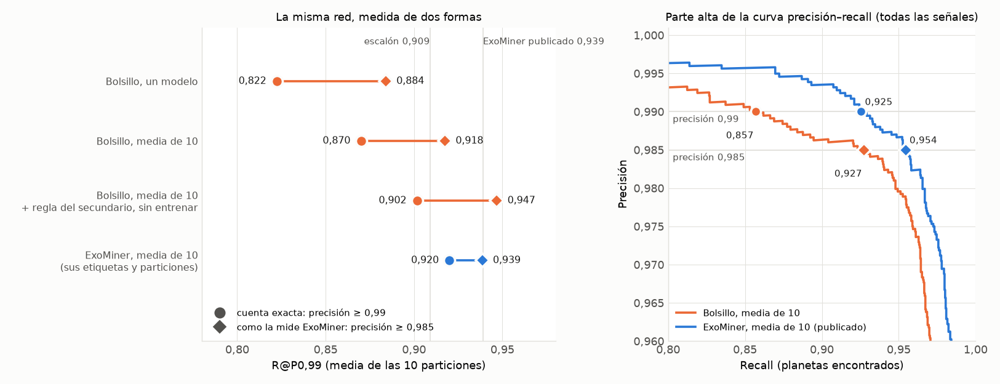

# Hito 5, paso 1 · Diagnóstico: por qué el modelo de bolsillo se queda en 0,822 y ExoMiner publica 0,939



*Izquierda: R@P0,99, media de las 10 particiones, con las dos cuentas (● exacta, ◆ como la mide
ExoMiner). Derecha: todas las señales a la vez, con nuestras etiquetas; los números son el recall con
precisión 0,99 y con 0,985.*

<!-- resumen:inicio -->
**Resultado: la distancia de 0,117 en R@P0,99 es, en su mayor parte, de cómo se compara y no de lo que
sabe el modelo.** Tres cosas la explican, por este orden:

1. **Su cifra es de un conjunto y la nuestra de un modelo.** El 0,939 de ExoMiner es la media de
   **10 modelos por partición** (unos 2,5 millones de parámetros en total). Con nuestra media de 10
   modelos, el 0,822 sube a 0,870.
2. **Su «precisión 0,99» es, en la práctica, precisión ≥ 0,985.** ExoMiner publica su puntuación para
   cada señal. Con esas puntuaciones, sus etiquetas y sus particiones, nuestra medida exacta le da
   **0,920 ± 0,034**, no 0,939; el 0,939 ± 0,030 publicado sale, al milésimo, si la precisión se
   redondea a dos decimales. Medido así, nuestro conjunto de 10 da **0,918** (un modelo, 0,884).
3. **Lo que queda de verdad son unas pocas decenas de objetos**, y casi la mitad de los negativos que
   nos rompen la precisión son de un solo tipo que ExoMiner corrige en los datos y nosotros no: el
   eclipse secundario de una binaria, detectado como señal aparte en la misma estrella (15 de 42).
   ExoMiner les da 0,00 a todos. Una regla sin entrenar que usa solo ese dato (poner a cero la señal
   más débil de cada pareja «misma estrella, mismo periodo») ya sube nuestro conjunto de 10 a 0,902
   con la cuenta exacta y a **0,947** con la de ExoMiner.

Igual con igual (conjunto de 10 contra conjunto de 10, mismas señales, etiquetas, particiones y
medida), la distancia real es de **0,03 a 0,06** en R@P0,99 y de 0,003 en AUC-PR. Para llegar a 0,939
con la medida exacta habría que arreglar **17 objetos** de 31.045 (10 para llegar a 0,909).

**No hace falta volver a leer las curvas para el siguiente paso.** Lo primero se hace con lo que ya
hay: emparejar el secundario entre las señales de una misma estrella y estabilizar el modelo único
(la semilla mueve el resultado más que la partición). Juntas y sin entrenar nada (con la regla y la
semilla elegida con la validación), un solo modelo de 38.441 parámetros da **0,894** exacto, 0,920 con
la cuenta de ExoMiner y 0,9917 de AUC-PR, y el conjunto de 10 da 0,902 · 0,947 · 0,9931 frente a
0,932 · 0,950 · 0,9954 de ExoMiner con nuestras etiquetas. Después de eso **lo que falta es sobre todo
AUC-PR**, y está en unos 25 planetas mal puntuados, la mayoría de estrellas saturadas: por eso el
tercer paso es la magnitud Kepler (sección 6, «Camino recomendado»).
<!-- resumen:fin -->

Este documento es un estudio: no cambia el modelo. No se ha descargado ninguna curva de luz.

## Cómo se reproduce

```bash
uv sync
uv run python scripts/hito4_dr25_cv.py run          # predicciones y pesos del hito 4 (si no están ya)
uv run python scripts/hito5_diagnostico.py ablate   # ablaciones: 300 modelos; se puede parar y retomar
uv run python scripts/hito5_diagnostico.py occlude  # las mismas entradas a cero sobre los modelos guardados (minutos)
uv run python scripts/hito5_diagnostico.py report   # tablas de este documento, la figura, hito5_diagnostico.json y hito5_errores.csv
uv run python scripts/hito5_diagnostico.py ablate --quick   # prueba de humo: 1 partición, 1 semilla, 1 época
```

`ablate` acepta `--configs`, `--seeds` y `--shard i/n` (para repartir el trabajo entre *n* procesos).
`report` baja, además de las tablas del hito 4, tres ficheros pequeños: más columnas del KOI acumulado
y la tabla de planetas del NASA Exoplanet Archive (para describir los errores, nunca como entrada), las
tablas 3 y 13 de ExoMiner (de la fuente del artículo en arXiv, comprobadas con SHA-256) y sus tablas de
particiones (del repositorio público de ExoMiner, en un commit fijo). Solo datos: no se usa código suyo.

## 1. Paridad de protocolo: ExoMiner frente a nosotros

Fuentes: el artículo (Valizadegan y otros 2022, arXiv:2111.10009v2; las secciones, tablas y algoritmos
se citan con la numeración de esa versión) y el repositorio público `nasa/ExoMiner` en dos commits de
las fechas del artículo: `199cd1d` (21-10-2021) y `4baa577` (10-11-2021; el artículo se envió el
19-11-2021). El código se ha leído; no se ha copiado ni ejecutado.

### Lo que decide la comparación

| | ExoMiner | Dónde lo dice | Nosotros (hito 4) | ¿Igual? |
|---|---|---|---|---|
| Señales | TCE de Kepler Q1–Q17 DR25 sin los «rogue» | § 4.1 | Las mismas | Sí |
| Planetas (PC) | KOI confirmados del KOI acumulado **bajado en febrero de 2020**: 2.291 | § 4.1 y su nota al pie; tabla 2 | KOI confirmados del KOI acumulado del **20-11-2026**: 2.724 | **No**: 440 planetas más (confirmados después) y 7 menos (ver abajo) |
| Falsos positivos (AFP) | `CERTIFIED FP` de la tabla de falsos positivos certificados: 3.538 | § 4.1; tabla 2 | Lo mismo: 3.539 | Sí (1 más) |
| No transitorios (NTP) | Señales que no llegaron a KOI, más `CERTIFIED FA`: 24.779 | § 4.1; tabla 2 | Lo mismo: 24.782 | Sí (2 más; su tabla 3 trae 24.780) |
| Candidatos sin confirmar | Fuera | § 4.1 | Fuera | Sí |
| Partición | 10 particiones **por estrella**; en cada vuelta 8 entrenan, 1 valida y 1 prueba | § 4.1 | Igual (`splits.star_folds`), con otro reparto al azar | Sí en el método; el reparto es otro |
| **Qué se mide** | **La media de las puntuaciones de 10 modelos por partición**: «we trained ExoMiner ten times and report the average score for each fold» | § 4.2, punto 6. En el código, `create_ensemble` promedia las salidas (`models/models_keras.py`, commit `4baa577`). Su tabla 3 trae una sola puntuación por señal | Cifra principal: **un modelo** (media de las medidas de 10 semillas). Aparte, la media de 10 | **No**: su 0,939 se compara con nuestra «media de 10» |
| Parámetros de lo que se mide | 10 × ≈ 252.647 ≈ **2,53 millones** (el artículo no da la cifra; contados a mano en el [hito 4](hito4.md)) | Figura 9 y § 3.6 | Un modelo: 38.441. Media de 10: 384.410 | Conjunto contra conjunto: 6,6 veces menos. **Un modelo nuestro contra su conjunto: 66 veces menos** |
| AUC-PR y R@P0,99: dos formas | (1) «Todas las señales a la vez», juntando las 10 partes de prueba (0,936); (2) media de las 10 particiones ± intervalo del 99 % con la t de Student (0,939 ± 0,030) | Pie de la tabla 4; § 5.1; tabla 5 | Las dos; el intervalo, del 95 % | Sí (aquí se dan los dos intervalos) |
| **R@P0,99: la cuenta** | «the value of recall for precision = p». El guion que la calcula no está en el repositorio. Sus 12 cifras de la tabla 5 que se pueden recalcular salen si la precisión **se redondea a dos decimales** (0,99 ⇒ ≥ 0,985) | § 4.3; tabla 5; comprobación en la [sección 2](#2-comparación-directa-con-las-puntuaciones-que-publica-exominer) | Exacta: el mayor recall con precisión ≥ 0,99 (`training.recall_at_precision`) | **No**: la suya es más laxa. Desde ahora se dan las dos |
| AUC-PR: la cuenta | `tf.keras.metrics.AUC(curve="PR", num_thresholds=1000, summation_method="interpolation")` | `src/utils_metrics.py` y `num_thr: 1000` en `src_cv/config_cv_train.yaml`, commit `4baa577` | Área exacta por escalones, como scikit-learn | Sí en la práctica: con sus puntuaciones, 0,9947 frente a 0,9948 |
| Umbral para precisión y recall | 0,5 | § 4.3 | El de mejor F1 en validación (y 0,5 de referencia) | No, pero no afecta a AUC-PR ni a R@P0,99 |
| Puntuaciones por señal | **Publicadas**: tabla 3 (las 30.609 con etiqueta, en validación cruzada) y tabla 13 (1.921 KOI sin etiqueta) | Tablas 3 y 13, «The full table is available online»; van en la fuente de arXiv | `data/hito4/preds/` (no publicadas aún) | — |

### Entradas

ExoMiner usa vistas de **301** tramos (órbita entera) y **31** (tránsito), no 2.001 y 201 (§ 3.4;
algoritmo 2). Cada prueba va por su rama, con sus escalares dentro (§ 3.4; figura 4).

| Entrada de ExoMiner | Dónde lo dice | Nosotros | ¿Nos falta? |
|---|---|---|---|
| Flujo, órbita entera (301) y tránsito (31); mediana 0, mínimo −1 | § 3.5, algoritmo 2 | Global (2.001) y local (201), misma normalización | No (más resolución, sin suavizar) |
| Profundidad del tránsito (escalar) | § 3.4 | `tce_depth` | No |
| Impares y pares (31 + 31), en la escala del tránsito; **la misma rama para las dos y una resta** de sus características | § 3.4; § 3.5 | Vistas impar y par (201 + 201) como dos canales de la rama local; sin resta | Distinto. Ellos no tienen `tce_bin_oedp_stat`; nosotros sí |
| Secundario (31), normalizado con el mayor de las dos profundidades; escalares: MES máximo del secundario, su profundidad, estadísticos de albedo y de temperatura | § 3.5 | Vista del secundario (201) en la fase de `tce_maxmesd`; los mismos 4 escalares más `wst_robstat` | No |
| **Corrección del secundario entre señales de la misma binaria**: si una señal es el secundario de otra, se le asigna la otra como secundario y se corrigen sus 4 escalares. 2.089 señales | § 3.5, «Data Correction» | **Nada** | **Sí. Es la falta que más pesa (sección 3)** |
| Corrección del periodo de 5 planetas confirmados con el del KOI acumulado | § 3.5, «Data Correction» | Nada | Sí, pero no se debe copiar tal cual: usa el catálogo de KOI solo para los planetas, o sea, la etiqueta |
| Centroide, órbita entera (301) y tránsito (31): **posición de la fuente del tránsito** en segundos de arco (el desplazamiento dividido por la profundidad), mediana 0, dividido por la desviación **del conjunto de entrenamiento** | § 3.5 (ecuaciones de la posición de la fuente) y algoritmo 4 | **Módulo** del desplazamiento del centro de luz (sin dividir por la profundidad), dividido por la dispersión **de la propia vista** | **Distinto y más pobre**: el módulo pierde el signo y la señal por debajo del ruido; dividir por la propia vista pierde el tamaño. Arreglarlo pide releer las curvas |
| Escalares de centroide: `tce_fwm_stat`, `tce_dikco_msky`, `tce_dicco_msky` y sus dos errores | § 3.4; `src_cv/config_cv_train.yaml` | Los mismos 5 | No |
| Otros diagnósticos DV: reflejos (`tce_cap_stat`, `tce_hap_stat`), `boot_fap`, banda rodante (normalizada), periodo y radio del planeta | § 3.5, «Other DV metrics» | Los mismos (la banda rodante sin normalizar, con `tce_num_transits` aparte) | No |
| Estrella: temperatura, radio, **masa, densidad**, gravedad y metalicidad, del catálogo estelar de DR25 **revisado con Gaia DR2** | § 3.5, «Other DV metrics» | Temperatura, radio, gravedad y metalicidad de la tabla de señales | **Sí**: masa, densidad y la revisión con Gaia |
| *No las tiene* | — | 11 escalares más: `tce_duration`, `tce_ror`, `tce_impact`, `tce_dor`, `tce_model_snr`, `tce_max_mult_ev`, `tce_max_sngle_ev`, `tce_num_transits`, `tce_chisq1`, `tce_chisq2`, `tce_bin_oedp_stat` | Al revés: las tenemos nosotros |
| *Dice que le faltan* (trabajo futuro): magnitud Kepler, para saber si la estrella satura; número de tránsitos e incertidumbre de la profundidad de impares y pares | § 6.2 y § 11.2 | Tampoco (los contadores de tránsitos impares y pares están guardados desde el hito 3, sin usar) | Sí, a los dos |

En total, ExoMiner lee 7 vistas y 22 escalares; nosotros, 7 vistas y 32 escalares.

### Normalización y receta

| | ExoMiner | Dónde lo dice | Nosotros |
|---|---|---|---|
| Escalares | Mediana y desviación típica del entrenamiento; recorte a 20 σ; `boot_fap` en logaritmo | Algoritmo 3; § 3.5 | Transformación por columna (logaritmos), mediana y rango intercuartílico del entrenamiento, recorte a 8 |
| Limpieza de la curva | Spline con los tránsitos de la señal quitados e interpolados | Algoritmo 1 | Spline (nodos elegidos por BIC) con los tránsitos de **todas** las señales de la estrella enmascarados |
| Arquitectura | 6 ramas convolucionales (núcleo 6; 16, 32 y 64 filtros), una capa de 4 neuronas al final de cada rama, 4 capas de 128, PReLU, sin normalización por lotes, abandono 0,03 | § 3.6; figura 9; `config_cv_train.yaml` | 2 ramas separables (global, 2 canales; local, 5 canales) con normalización por lotes, promedio y máximo globales, rama de escalares y capa de 32; abandono 0,1 |
| Cómo se eligió | Búsqueda de hiperparámetros **BOHB** sobre arquitectura, optimizador y paso de aprendizaje. El artículo no dice con qué partición ni cuántas configuraciones | § 3.6. El nombre de la carpeta de esa búsqueda en el código (`…bohb_keplerdr25…starshuffle…`) apunta a los mismos datos de DR25 | A mano en los hitos 2 y 3; sin búsqueda |
| Optimizador | Adam, paso 6,73·10⁻⁵ | § 3.6 | AdamW, paso 10⁻³ con coseno, decaimiento 10⁻⁴ |
| Lote y épocas | Lote 32; hasta 300 épocas con parada temprana (paciencia 20 sobre el AUC-PR de validación; se queda con los mejores pesos) | `src_cv/config_cv_train.yaml`, commit `199cd1d` (el artículo solo menciona la parada temprana, § 6.1) | Lote 64; 20 épocas; se queda con la época de mejor AUC-PR en validación |
| Pérdida y desequilibrio | Entropía cruzada binaria, sin pesos por clase | `config_cv_train.yaml`: `category_weights: null`, `use_kepler_ce: false` | Igual |
| Aumentos | Ninguno | `config_cv_train.yaml`: `data_augmentation: false` | Inversión temporal al azar |
| Modelos por partición | 10, promediados | § 4.2 | 10 (se da uno y la media) |

Los valores de `config_cv_train.yaml` son los del fichero publicado en esas fechas; los ficheros de
configuración del repositorio se usaban también para pruebas (el del commit `4baa577` trae 2 épocas y 1
modelo), así que lote y épocas valen como indicio, no como dato del artículo.

## 2. Comparación directa con las puntuaciones que publica ExoMiner

ExoMiner publica su puntuación para cada señal: la tabla 3 trae las 30.609 señales con etiqueta
(puntuadas en validación cruzada: cada una por los 10 modelos de la partición en la que estaba en
prueba) y la tabla 13 los 1.921 KOI que dejó sin etiqueta (puntuados por la media de los modelos de
las 10 particiones; ninguno entrenó con ellos). Entre las dos cubren 31.042 de nuestras 31.045
señales, incluidos los 440 planetas nuevos. Sus particiones están en el repositorio. Con eso se pueden
medir las dos redes con el mismo código.

<!-- directa:inicio -->
**Qué lectura de «recall con precisión p» reproduce la tabla 5 de su artículo.** Con sus propias puntuaciones y etiquetas (tabla 3 del artículo, todas las señales a la vez):

| Modelo de su tabla 3 | Precisión p | Publicado | Exacto (precisión ≥ p) | Precisión redondeada a dos decimales ≥ p |
|---|---|---|---|---|
| Astronet (el suyo) | 0,99 | 0,001 | 0,001 ✓ | 0,001 ✓ |
| Astronet (el suyo) | 0,975 | 0,333 | 0,333 ✓ | 0,333 ✓ |
| Astronet (el suyo) | 0,95 | 0,643 | 0,619 | 0,643 ✓ |
| ExoNet | 0,99 | 0,506 | 0,422 | 0,506 ✓ |
| ExoNet | 0,975 | 0,619 | 0,619 ✓ | 0,619 ✓ |
| ExoNet | 0,95 | 0,803 | 0,781 | 0,803 ✓ |
| ExoMiner | 0,99 | 0,936 | 0,918 | 0,936 ✓ |
| ExoMiner | 0,975 | 0,966 | 0,966 ✓ | 0,966 ✓ |
| ExoMiner | 0,95 | 0,986 | 0,984 | 0,986 ✓ |
| ExoMiner-TCE | 0,99 | 0,949 | 0,936 | 0,949 ✓ |
| ExoMiner-TCE | 0,975 | 0,960 | 0,960 ✓ | 0,960 ✓ |
| ExoMiner-TCE | 0,95 | 0,990 | 0,989 | 0,990 ✓ |

La lectura redondeada acierta 12 de 12 cifras al milésimo; la exacta, 5 de 12 (las de p = 0,975, donde redondear a dos decimales no cambia nada, y la de Astronet con p = 0,99). Por particiones, con **sus** particiones: redondeada 0,939 ± 0,030 (publicado: 0,939 ± 0,030); exacta 0,920 ± 0,034 (media ± intervalo del 99 %). Con p = 0,975 y 0,95 pasa lo mismo: 0,964 ± 0,009 y 0,988 (publicado: 0,964 ± 0,009 y 0,988).

**Las dos redes con las mismas señales, etiquetas, particiones y medida.** Media sobre las 10 particiones ± intervalo del **99 %** (el que usa ExoMiner), y entre paréntesis todas las señales a la vez:

| Quién | Etiquetas | Particiones | Planetas | R@P0,99 exacto | R@P0,99 como lo mide ExoMiner (precisión ≥ 0,985) | AUC-PR |
|---|---|---|---|---|---|---|
| *ExoMiner, publicado (media de 10 modelos por partición)* | *suyas (2020)* | *suyas* | *2.291* | — | *0,939 ± 0,030 (0,936)* | *0,995 ± 0,002 (0,995)* |
| ExoMiner, recalculado con sus puntuaciones | suyas (2020) | suyas | 2.291 | 0,920 ± 0,034 (0,918) | 0,939 ± 0,030 (0,936) | 0,995 ± 0,002 (0,995) |
| ExoMiner | suyas (2020) | nuestras | 2.284 | 0,921 ± 0,041 (0,919) | 0,939 ± 0,035 (0,938) | 0,995 ± 0,003 (0,995) |
| ExoMiner | nuestras (2026) | nuestras | 2.724 | 0,932 ± 0,032 (0,925) | 0,950 ± 0,033 (0,954) | 0,995 ± 0,003 (0,995) |
| ExoMiner | nuestras, sin los planetas que validó el propio ExoMiner | nuestras | 2.354 | 0,922 ± 0,039 (0,915) | 0,939 ± 0,037 (0,940) | 0,994 ± 0,003 (0,994) |
| Bolsillo, media de 10 | nuestras (2026) | nuestras | 2.724 | 0,870 ± 0,083 (0,857) | 0,918 ± 0,031 (0,927) | 0,992 ± 0,004 (0,991) |
| Bolsillo, media de 10 | nuestras, sin los planetas que validó el propio ExoMiner | nuestras | 2.354 | 0,845 ± 0,115 (0,843) | 0,912 ± 0,040 (0,887) | 0,991 ± 0,005 (0,990) |
| Bolsillo, media de 10 | suyas (2020) | nuestras | 2.284 | 0,829 ± 0,118 (0,835) | 0,916 ± 0,041 (0,888) | 0,991 ± 0,005 (0,990) |
| Bolsillo, un modelo | nuestras (2026) | nuestras | 2.724 | 0,822 ± 0,085 (0,783) | 0,884 ± 0,040 (0,869) | 0,989 ± 0,004 (0,987) |
| Bolsillo, un modelo | suyas (2020) | nuestras | 2.284 | 0,780 ± 0,126 (0,758) | 0,865 ± 0,061 (0,838) | 0,988 ± 0,006 (0,986) |

Comprobaciones con sus puntuaciones y etiquetas: AUC-PR 0,9948 (publicado 0,995; con el estimador de Keras de 1.000 umbrales que usa su código, 0,9947), precisión 0,968 y recall 0,974 con umbral 0,5 (publicado 0,968 y 0,974), 74 falsas alarmas y 60 planetas perdidos (su sección 6.2 dice 74 y 60).

**Etiquetas.** De sus 30.609 señales con etiqueta, 30.602 tienen aquí la misma clase; las 7 restantes son planetas suyos que aquí quedan sin etiqueta (confirmados y a la vez falsos positivos certificados). Nosotros añadimos 440 planetas confirmados después de su descarga (por referencia de descubrimiento: Valizadegan et al. 2022: 301, Valizadegan et al. 2023: 69, Armstrong et al. 2021: 50, (sin referencia en la tabla de planetas): 12, Ofir et al. 2025: 2) y 3 negativos. 370 de nuestros positivos los validó el propio ExoMiner (Valizadegan y otros 2022 y 2023), con su puntuación como criterio: de los 440 nuevos, ExoMiner da más de 0,99 a 260 y el bolsillo a 139.
<!-- directa:fin -->

**Lectura.**

* **La cifra publicada no es «precisión ≥ 0,99».** Con la cuenta exacta, ExoMiner tiene 0,920 con sus
  etiquetas y particiones, y 0,918 con todas las señales a la vez. La explicación más sencilla que
  reproduce sus 12 cifras es un redondeo de la precisión a dos decimales; no se ha podido leer en su
  código, porque ese guion no está publicado. No es un reproche: la diferencia entre 0,985 y 0,99 son
  una docena de señales, pero es justo de lo que depende esta medida.
* **Igual con igual, la distancia es menor de lo que decía el hito 4.** Conjunto de 10 contra conjunto
  de 10, con nuestras etiquetas y particiones: 0,870 frente a 0,932 con la cuenta exacta (0,062), y
  0,918 frente a 0,950 con la suya (0,032). Frente a su cifra publicada, 0,918 frente a 0,939 (0,021).
  El escalón intermedio (0,909) el conjunto de 10 ya lo pasa con su cuenta; con la exacta, no.
* **Las etiquetas nuevas no nos perjudican: nos ayudan, y a ExoMiner más.** El hito 4 suponía que los
  planetas confirmados desde 2020 hacían el conjunto más difícil. Es al revés: con sus etiquetas de
  2020 el conjunto de 10 baja de 0,870 a 0,829 (hay los mismos negativos arriba y menos planetas con
  que compensarlos). ExoMiner sube de 0,921 a 0,932 con las nuestras, en parte por construcción: 370
  de los planetas nuevos los validó él mismo, y su criterio fue darles más de 0,99. Sin esos 370,
  queda en 0,922.
* **Un modelo contra un modelo no se puede comparar** con lo publicado: no hay cifras de un solo
  ExoMiner. Lo que sí se puede es un modelo nuestro contra su conjunto: 0,822 (exacta) y 0,884 (la
  suya) frente a 0,920 y 0,939.
* **En AUC-PR** faltan 0,003 con el conjunto (0,992 frente a 0,995) y 0,006 con un modelo.

## 3. Análisis de errores

<!-- errores:inicio -->
Media de las 10 semillas, todas las señales a la vez (2.724 planetas). Hoy el mejor punto con precisión ≥ 0,99 está en la puntuación 0,901: 2.334 planetas y 23 negativos por encima, recall 0,857.

| Objetivo | Planetas que hacen falta | Puntuación del último | Negativos por encima | Negativos que caben | Objetos que hay que arreglar (mínimo) |
|---|---|---|---|---|---|
| 0,909 | 2.477 | 0,833 | 35 | 25 | **10** |
| 0,939 | 2.558 | 0,737 | 42 | 25 | **17** |

«Arreglar» un objeto es darle la puntuación que le toca: un negativo deja de estar arriba o un planeta sube. El mínimo se calcula probando todos los umbrales (`diagnosis.best_recall_with_fixes`). Otras formas de contarlo:

| Cómo se mide | Para 0,909 | Para 0,939 |
|---|---|---|
| Media de 10, todas las señales, precisión exacta | 10 | 17 |
| Media de 10, todas las señales, precisión como la mide ExoMiner (≥ 0,985) | 0 | 4 |
| Media de 10, media de las 10 particiones (reparto óptimo entre particiones) | 4 | 13 |
| Un solo modelo, todas las señales (media de las 10 semillas; mínimo–máximo) | 25,6 (19–36) | 53,3 (39–73) |
| Un solo modelo, media de las 10 particiones (media de las 10 semillas) | 13,4 | 30,1 |

**Los negativos que rompen la precisión.** Por encima de la puntuación 0,737 (la del planeta n.º 2.558) hay 42 negativos y solo caben 25. Por causa probable (reglas sobre los catálogos públicos, no inspección visual; cada objeto va a la primera causa que le aplica):

| Causa probable | Por encima del corte de 0,939 | De ellos, por encima del de 0,909 | AFP / NTP | ExoMiner también les da ≥ 0,5 | ExoMiner les da < 0,1 | R@P0,99 si se arreglan solo estos (todas las señales · media de particiones) |
|---|---|---|---|---|---|---|
| Eclipse secundario de una binaria, detectado como señal aparte en la misma estrella | 15 | 13 | 0 / 15 | 0 | 15 | 0,931 · 0,925 |
| Binaria eclipsante en la propia estrella (secundario, impares/pares o forma en V) | 8 | 6 | 8 / 0 | 6 | 1 | 0,884 · 0,900 |
| Contaminación de otra estrella (mismo periodo y época que otra señal) | 7 | 6 | 7 / 0 | 5 | 0 | 0,877 · 0,883 |
| Binaria de fondo: el centro de luz se desplaza en el tránsito | 5 | 4 | 5 / 0 | 3 | 0 | 0,877 · 0,887 |
| Otra falsa alarma (no parecida a un tránsito para el Robovetter) | 4 | 3 | 0 / 4 | 2 | 1 | 0,874 · 0,898 |
| Etiqueta dudosa: falso positivo certificado que el archivo da hoy como candidato | 2 | 2 | 2 / 0 | 1 | 1 | 0,862 · 0,873 |
| Falsa alarma con poca señal (MES < 10) | 1 | 1 | 0 / 1 | 0 | 1 | 0,862 · 0,870 |

Los 42 negativos, de mayor a menor puntuación (la lista completa hasta la puntuación 0,5 está en [`hito5_errores.csv`](hito5_errores.csv)). «Semillas» es en cuántas de las 10 queda por encima del umbral de hoy (0,901).

| N.º | Señal (KIC-n) | KOI | Clase | Bolsillo | Semillas | ExoMiner | Periodo (d) | MES | Causa probable | Banderas del Robovetter |
|---|---|---|---|---|---|---|---|---|---|---|
| 1 | 12004971-1 | K03194.01 | AFP | 0,995 | 10 | 0,995 | 10,81 | 14,0 | Binaria eclipsante | CENT_SATURATED |
| 2 | 9008737-1 | K02768.03 | NTP | 0,987 | 10 | 0,885 | 11,84 | 10,8 | Otra falsa alarma | — |
| 3 | 8492101-1 | K04437.01 | AFP | 0,985 | 10 | 0,996 | 4,06 | 16,1 | Contaminación (efemérides) | CENT_KIC_POS, EPHEM_MATCH |
| 4 | 7222086-1 | K01701.01 | AFP | 0,983 | 9 | 0,740 | 2,44 | 39,6 | Binaria eclipsante | CENT_SATURATED |
| 5 | 7661065-1 | K02307.01 | AFP | 0,981 | 10 | 0,994 | 4,15 | 21,6 | Binaria eclipsante | — |
| 6 | 4914737-2 | — | NTP | 0,976 | 10 | 0,001 | 8,65 | 8,7 | Secundario de binaria | IS_SEC_TCE, EPHEM_MATCH |
| 7 | 7363829-1 | — | NTP | 0,971 | 10 | 0,198 | 393,72 | 73,6 | Otra falsa alarma | INDIV_TRANS_MARSHALL_SKYE, INCONSISTENT_TRANS, CENT_FEW_DIFF… |
| 8 | 5471059-2 | — | NTP | 0,964 | 10 | 0,001 | 2,64 | 16,9 | Secundario de binaria | IS_SEC_TCE |
| 9 | 4947556-1 | K03936.01 | AFP | 0,954 | 10 | 0,000 | 141,61 | 25,9 | Etiqueta dudosa | HALO_GHOST |
| 10 | 11392618-1 | K01623.01 | AFP | 0,953 | 9 | 0,996 | 110,92 | 37,3 | Binaria de fondo (centroide) | CENT_UNRESOLVED_OFFSET |
| 11 | 7023960-2 | — | NTP | 0,951 | 8 | 0,000 | 30,88 | 16,7 | Secundario de binaria | IS_SEC_TCE |
| 12 | 8414216-1 | K07036.01 | AFP | 0,949 | 8 | 0,980 | 11,93 | 12,5 | Contaminación (efemérides) | CENT_KIC_POS, EPHEM_MATCH |
| 13 | 9849884-1 | K04516.01 | AFP | 0,942 | 8 | 0,893 | 5,36 | 15,7 | Contaminación (efemérides) | EPHEM_MATCH |
| 14 | 11869052-1 | K00120.01 | AFP | 0,940 | 8 | 0,133 | 20,55 | 93,6 | Binaria eclipsante | — |
| 15 | 5544450-1 | K03226.01 | NTP | 0,939 | 7 | 0,765 | 4,29 | 14,4 | Otra falsa alarma | — |
| 16 | 10187017-6 | K00082.06 | AFP | 0,930 | 8 | 0,984 | 22,41 | 8,5 | Binaria de fondo (centroide) | CENT_SATURATED |
| 17 | 7048016-1 | — | NTP | 0,926 | 9 | 0,000 | 1,39 | 8,8 | Poca señal | LPP_DV, LPP_ALT, MOD_NONUNIQ_DV, MOD_NONUNIQ_ALT |
| 18 | 7362696-2 | — | NTP | 0,922 | 8 | 0,000 | 4,93 | 20,1 | Secundario de binaria | IS_SEC_TCE |
| 19 | 10345478-2 | — | NTP | 0,921 | 6 | 0,000 | 14,50 | 11,7 | Secundario de binaria | IS_SEC_TCE |
| 20 | 6500206-2 | — | NTP | 0,921 | 7 | 0,037 | 13,37 | 13,9 | Secundario de binaria | IS_SEC_TCE |
| 21 | 8963721-1 | K02233.01 | AFP | 0,916 | 6 | 0,775 | 1,81 | 49,5 | Contaminación (efemérides) | EPHEM_MATCH |
| 22 | 2446113-1 | K00379.01 | AFP | 0,907 | 6 | 0,985 | 6,72 | 40,4 | Binaria de fondo (centroide) | CENT_UNRESOLVED_OFFSET |
| 23 | 7375795-1 | K01378.01 | AFP | 0,903 | 5 | 0,323 | 19,30 | 35,9 | Binaria de fondo (centroide) | CENT_RESOLVED_OFFSET |
| 24 | 8176650-2 | — | NTP | 0,901 | 8 | 0,000 | 15,80 | 28,3 | Secundario de binaria | IS_SEC_TCE |
| 25 | 7975727-2 | — | NTP | 0,898 | 7 | 0,000 | 22,42 | 38,4 | Secundario de binaria | IS_SEC_TCE |
| 26 | 6707908-1 | K02014.01 | AFP | 0,892 | 8 | 0,538 | 2,47 | 34,0 | Binaria eclipsante | — |
| 27 | 8937762-1 | K04668.01 | AFP | 0,890 | 8 | 0,660 | 7,54 | 10,6 | Binaria eclipsante | — |
| 28 | 5035972-2 | — | NTP | 0,883 | 6 | 0,000 | 49,27 | 49,5 | Secundario de binaria | IS_SEC_TCE |
| 29 | 8686150-2 | — | NTP | 0,880 | 6 | 0,000 | 51,43 | 51,9 | Secundario de binaria | IS_SEC_TCE |
| 30 | 4914709-2 | — | NTP | 0,875 | 7 | 0,005 | 8,65 | 9,0 | Secundario de binaria | IS_SEC_TCE, EPHEM_MATCH |
| 31 | 9772531-1 | K00950.01 | AFP | 0,869 | 6 | 0,762 | 31,20 | 595,1 | Etiqueta dudosa | CENT_KIC_POS |
| 32 | 1571511-2 | — | NTP | 0,863 | 6 | 0,000 | 14,02 | 23,8 | Secundario de binaria | IS_SEC_TCE |
| 33 | 10031918-1 | K04894.01 | AFP | 0,857 | 4 | 0,206 | 8,59 | 8,7 | Contaminación (efemérides) | EPHEM_MATCH |
| 34 | 8074805-2 | — | NTP | 0,855 | 6 | 0,000 | 170,86 | 44,4 | Secundario de binaria | IS_SEC_TCE |
| 35 | 3547760-1 | K04535.01 | AFP | 0,839 | 5 | 0,646 | 9,85 | 8,0 | Contaminación (efemérides) | — |
| 36 | 11512820-1 | — | NTP | 0,806 | 4 | 0,000 | 38,93 | 11,0 | Otra falsa alarma | MOD_NONUNIQ_DV, MOD_TER_DV, CENT_SATURATED |
| 37 | 6206470-1 | K05252.01 | AFP | 0,806 | 3 | 0,394 | 1,80 | 11,7 | Contaminación (efemérides) | EPHEM_MATCH |
| 38 | 7531677-1 | K02601.01 | AFP | 0,798 | 3 | 0,481 | 2,62 | 20,2 | Binaria de fondo (centroide) | CENT_UNRESOLVED_OFFSET |
| 39 | 10464666-2 | — | NTP | 0,783 | 3 | 0,000 | 131,74 | 21,5 | Secundario de binaria | IS_SEC_TCE |
| 40 | 5009189-2 | — | NTP | 0,776 | 1 | 0,002 | 4,94 | 13,6 | Secundario de binaria | IS_SEC_TCE |
| 41 | 7767559-1 | K00895.01 | AFP | 0,769 | 4 | 0,852 | 4,41 | 735,7 | Binaria eclipsante | MOD_SEC_DV, HAS_SEC_TCE |
| 42 | 6973796-1 | K03726.01 | AFP | 0,747 | 6 | 0,023 | 115,99 | 245,6 | Binaria eclipsante | HAS_SEC_TCE, CENT_KIC_POS |

De esos 42, ExoMiner también da 0,5 o más a 17. Los «secundarios de binaria» los marca el Robovetter con `IS_SEC_TCE` (1.136 señales con etiqueta): 991 de ellas comparten estrella con otra señal del mismo periodo (±1 %), algo que se calcula solo con la tabla de señales. Esa condición la cumplen 6.254 negativos y 19 planetas.

**Una prueba sin entrenar nada.** Si a la señal más débil de cada pareja «misma estrella, mismo periodo» (la de menor estadístico de detección; 3.348 señales, 2 de ellas planetas) se le pone puntuación 0, sin mirar ninguna etiqueta:

| | R@P0,99 exacto | R@P0,99 como lo mide ExoMiner | AUC-PR |
|---|---|---|---|
| Media de 10, hoy | 0,870 ± 0,058 | 0,918 ± 0,022 | 0,9922 ± 0,0026 |
| Media de 10, con esa regla | 0,902 ± 0,053 | 0,947 ± 0,020 | 0,9931 ± 0,0025 |
| Un modelo, hoy | 0,822 ± 0,059 | 0,884 ± 0,028 | 0,9894 ± 0,0029 |
| Un modelo, con esa regla | 0,869 ± 0,045 | 0,914 ± 0,019 | 0,9909 ± 0,0027 |

(Media sobre las 10 particiones ± intervalo del 95 %.) La regla quita 13 de los 15 secundarios que estaban por encima del corte, y después de aplicarla harían falta 4 arreglos más para 0,939 (media de 10, todas las señales). No es una propuesta de modelo: es la medida de cuánto hay que ganar dándole ese dato a la red.

**Los planetas que se pierden.** Con el umbral de hoy quedan fuera 390 planetas. Si se arreglaran los negativos, los 224 que están entre el corte de 0,939 y el umbral de hoy entrarían solos; los 166 que quedan por debajo del corte seguirían perdidos (0,939 admite perder 166). Por causa probable:

| Causa probable | Por debajo del corte de 0,939 | ExoMiner también les da < 0,5 | Confirmados después de 2020 | Entre el corte y el umbral de hoy | Planetas con esa condición en total |
|---|---|---|---|---|---|
| Sin causa clara en los catálogos | 49 | 4 | 12 | 121 | 2.181 |
| Poca señal (MES < 12) | 31 | 10 | 11 | 51 | 241 |
| Tránsito profundo o planeta gigante (> 10 radios terrestres): se parece a una binaria | 20 | 4 | 2 | 23 | 99 |
| Estrella saturada o muy brillante: la prueba de centroide no es fiable | 17 | 11 | 2 | 7 | 66 |
| Pocos tránsitos (5 o menos) | 13 | 8 | 4 | 6 | 28 |
| Secundario visible (ocultación de un júpiter caliente, u otro planeta en esa fase) | 11 | 5 | 1 | 4 | 24 |
| Periodo muy corto (< 1 día) | 9 | 3 | 0 | 7 | 48 |
| El Robovetter tampoco la ve como tránsito | 6 | 4 | 1 | 3 | 15 |
| Periodo mal: el del catálogo de señales es el doble o la mitad del real | 4 | 1 | 0 | 0 | 6 |
| Etiqueta en disputa: planeta marcado como controvertido en el archivo | 3 | 1 | 0 | 0 | 5 |
| Prueba de centroide o de reflejos marcada | 3 | 2 | 1 | 2 | 11 |

Los 30 planetas con peor puntuación (la lista completa, en el CSV):

| Señal (KIC-n) | Planeta | Bolsillo | ExoMiner | Periodo (d) | MES | Tránsitos | Radio (R⊕) | Causa probable |
|---|---|---|---|---|---|---|---|---|
| 6278762-5 | Kepler-444 b | 0,000 | 0,010 | 3,60 | 22,8 | 342 | 0,8 | Estrella saturada |
| 8561063-3 | Kepler-42 c | 0,000 | 0,159 | 0,91 | 10,5 | 1.193 | 0,3 | Periodo mal |
| 8416523-1 | Kepler-1604 b | 0,000 | 0,887 | 0,68 | 12,5 | 1.956 | 1,1 | Periodo mal |
| 10904857-1 | Kepler-488 b | 0,000 | 0,117 | 3,12 | 1089,0 | 435 | 14,3 | Secundario visible |
| 6278762-3 | Kepler-444 d | 0,001 | 0,018 | 6,19 | 29,6 | 207 | 0,8 | Estrella saturada |
| 9941662-1 | Kepler-13 b | 0,001 | 0,009 | 1,76 | 6791,0 | 761 | 21,6 | Estrella saturada |
| 7303287-3 | Kepler-289 e | 0,001 | 0,000 | 330,07 | 8,5 | 4 | 4,4 | Pocos tránsitos |
| 3632418-1 | Kepler-21 b | 0,002 | 0,057 | 2,79 | 47,6 | 486 | 1,7 | Estrella saturada |
| 6278762-2 | Kepler-444 e | 0,005 | 0,012 | 7,74 | 30,2 | 169 | 0,8 | Estrella saturada |
| 7515679-1 | Kepler-1517 b | 0,016 | 0,458 | 5,55 | 154,7 | 238 | 18,5 | Secundario visible |
| 11187436-1 | Kepler-957 b | 0,018 | 0,450 | 5,91 | 128,1 | 232 | 5,7 | Tránsito profundo |
| 8873450-6 | Kepler-1975 b | 0,023 | 0,007 | 24,28 | 12,5 | 54 | 2,4 | Centroide o reflejos |
| 6278762-1 | Kepler-444 f | 0,023 | 0,321 | 9,74 | 31,8 | 135 | 1,0 | Estrella saturada |
| 11446443-1 | Kepler-1 b | 0,036 | 0,504 | 2,47 | 6468,0 | 432 | 13,2 | Estrella saturada |
| 5437945-1 | Kepler-460 b | 0,043 | 0,390 | 440,79 | 79,5 | 4 | 7,3 | Secundario visible |
| 9032900-2 | K00134.01 | 0,045 | 0,045 | 67,69 | 97,1 | 21 | 7,0 | No parece tránsito |
| 10963065-1 | Kepler-408 b | 0,045 | 0,511 | 2,47 | 21,6 | 426 | 0,8 | Estrella saturada |
| 10028792-2 | Kepler-87 c | 0,046 | 0,037 | 191,23 | 27,2 | 4 | 10,8 | Pocos tránsitos |
| 6061119-1 | Kepler-699 b | 0,053 | 0,194 | 27,81 | 739,9 | 50 | 13,9 | Tránsito profundo |
| 8459663-1 | Kepler-1593 b | 0,068 | 0,263 | 174,51 | 11,0 | 7 | 1,9 | Poca señal |
| 3861595-1 | Kepler-1658 b | 0,069 | 0,380 | 3,85 | 235,6 | 276 | 13,0 | Estrella saturada |
| 6278762-4 | Kepler-444 c | 0,073 | 0,254 | 4,55 | 27,6 | 252 | 0,7 | Estrella saturada |
| 10666592-1 | Kepler-2 b | 0,077 | 0,086 | 2,20 | 3862,0 | 611 | 16,8 | Estrella saturada |
| 3657758-2 | Kepler-1065 c | 0,082 | 0,482 | 2,37 | 9,1 | 348 | 1,5 | Poca señal |
| 11013201-1 | K00972.01 | 0,091 | 0,606 | 13,12 | 182,4 | 103 | 9,2 | Estrella saturada |
| 4570949-1 | Kepler-76 b | 0,105 | 0,172 | 1,54 | 1155,0 | 692 | 12,7 | Secundario visible |
| 7898352-1 | Kepler-302 c | 0,117 | 0,747 | 127,28 | 116,6 | 11 | 12,1 | Tránsito profundo |
| 6368175-1 | Kepler-1703 b | 0,131 | 0,350 | 21,19 | 8,7 | 63 | 0,8 | Poca señal |
| 10736489-1 | Kepler-1974 b | 0,138 | 0,000 | 6,84 | 28,9 | 198 | 2,7 | Sin causa clara |
| 8219268-1 | Kepler-91 b | 0,145 | 0,180 | 6,25 | 27,7 | 214 | 14,7 | No parece tránsito |
<!-- errores:fin -->

**Lectura.**

* **Un solo tipo de error explica casi la mitad del problema, y tiene arreglo sin datos nuevos.** Una
  binaria eclipsante da dos señales en la misma estrella y con el mismo periodo: el eclipse primario y
  el secundario. La segunda suele parecer un tránsito limpio y poco profundo. ExoMiner lo resuelve
  antes de entrenar (sección 1): a esa señal le pone como «secundario» el eclipse primario, que es
  hondo, y el modelo ve una binaria. Nosotros miramos el secundario en la fase que da el catálogo, que
  se calculó **después** de quitar el eclipse primario, así que no vemos nada. El arreglo no pide
  curvas: que dos señales compartan estrella y periodo se saca de la tabla de señales, y la vista del
  secundario en la fase correcta se puede reconstruir de la vista global ya guardada.
* **En el resto de los negativos ExoMiner falla casi igual que nosotros**: de los 27 que no son
  secundarios, da 0,5 o más a 17. Son contaminación de otra estrella (la bandera de «misma efeméride»
  del Robovetter, que ninguna de las dos redes tiene), binarias de fondo con desplazamiento pequeño y
  binarias que solo se distinguen por la forma en V. Arreglarlos sería ponerse por delante, no igualar.
* **Etiquetas.** Ninguno de los 42 negativos tiene aquí una clase distinta de la que le dio ExoMiner
  en 2020. Dos son dudosos: falsos positivos certificados que el archivo da hoy como candidatos.
* **Los planetas perdidos se parecen a los que pierde ExoMiner** (su § 6.2): estrellas saturadas donde
  el centroide engaña (Kepler-444, Kepler-21, Kepler-13), júpiteres calientes con ocultación visible,
  periodos al doble (Kepler-42 c, Kepler-1604 b) y señales de 3–5 tránsitos. No hace falta arreglarlos
  para llegar a 0,939: ese objetivo admite perder 166 planetas, justo los que quedan por debajo del
  corte. Lo que falta son los 224 planetas que hoy quedan tapados por negativos.

## 4. De dónde viene la dispersión: semilla o partición

<!-- dispersion:inicio -->
Descomposición de la dispersión de las 100 medidas (10 particiones × 10 semillas) del modelo de bolsillo completo (`diagnosis.variance_components`: efectos aleatorios de una vía):

| Medida | Media | Dispersión entre semillas (misma partición) | Dispersión entre particiones (quitada la de semillas) | Parte de la varianza que es de la partición |
|---|---|---|---|---|
| R@P0,99 exacto | 0,822 | 0,107 | 0,075 | 33 % |
| R@P0,99 como lo mide ExoMiner | 0,884 | 0,046 | 0,036 | 38 % |
| AUC-PR | 0,9894 | 0,0036 | 0,0039 | 54 % |

R@P0,99 exacto por partición (media de las 10 semillas · media de 10 modelos), con los planetas de cada una:

| Partición | 0 | 1 | 2 | 3 | 4 | 5 | 6 | 7 | 8 | 9 |
|---|---|---|---|---|---|---|---|---|---|---|
| Planetas | 252 | 269 | 261 | 253 | 253 | 259 | 291 | 260 | 310 | 316 |
| Un modelo (media de semillas) | 0,777 | 0,895 | 0,857 | 0,901 | 0,883 | 0,756 | 0,652 | 0,878 | 0,761 | 0,866 |
| Un modelo (mínimo–máximo de semillas) | 0,10–0,90 | 0,81–0,95 | 0,54–0,92 | 0,83–0,94 | 0,82–0,94 | 0,51–0,91 | 0,48–0,83 | 0,83–0,91 | 0,66–0,85 | 0,79–0,94 |
| Media de 10 modelos | 0,881 | 0,963 | 0,916 | 0,913 | 0,937 | 0,838 | 0,701 | 0,908 | 0,768 | 0,877 |

Cuánto da promediar semillas (media sobre las 10 particiones; grupos disjuntos de semillas):

| Modelos promediados | 1 | 2 | 3 | 5 | 10 |
|---|---|---|---|---|---|
| R@P0,99 exacto | 0,822 | 0,854 | 0,861 | 0,858 | 0,870 |
| R@P0,99 como lo mide ExoMiner | 0,884 | 0,901 | 0,905 | 0,913 | 0,918 |

Lo que ya dice la validación sobre cada modelo (sin mirar la prueba para elegir): un solo modelo por partición, elegido entre las 10 semillas.

| Qué modelo se usa en cada partición | R@P0,99 exacto | R@P0,99 como lo mide ExoMiner | AUC-PR |
|---|---|---|---|
| Una semilla cualquiera (media de las 10) | 0,822 ± 0,059 | 0,884 ± 0,028 | 0,9894 ± 0,0029 |
| La semilla con mejor AUC-PR en validación | 0,871 ± 0,047 | 0,899 ± 0,037 | 0,9907 ± 0,0026 |
| La semilla con mejor R@P0,99 en validación | 0,850 ± 0,046 | 0,900 ± 0,031 | 0,9900 ± 0,0025 |

La época elegida por la validación es de media la 12,9 de 20. Los 19 modelos que se quedaron con una época ≤ 8 (cuando el paso de aprendizaje aún es alto) dan 0,798 de R@P0,99; los demás, 0,828.
<!-- dispersion:fin -->

**Lectura.**

* **La semilla mueve el resultado más que la partición.** Con el mismo reparto de datos, dos
  entrenamientos difieren en 0,107 de R@P0,99 (desviación típica); cambiar de partición añade 0,075.
  Dos tercios de la varianza de un modelo suelto son de la semilla. Por eso promediar 2 o 3 modelos ya
  da casi todo lo que da promediar 10.
* **La validación ya sabe qué semilla es buena.** Quedarse, en cada partición, con el modelo de mejor
  AUC-PR en validación da 0,871: lo mismo que el conjunto de 10, con un solo modelo de 38.441
  parámetros a la hora de predecir. No se ha mirado la prueba para elegir. Cuesta 10 entrenamientos
  por modelo (unos 17 minutos sin otra carga).
* **Con la cuenta de ExoMiner la dispersión se reduce a menos de la mitad** (0,046 y 0,036): con
  precisión exacta ≥ 0,99 y unos 270 planetas por partición solo caben 2 negativos, y uno más o uno
  menos cambia el resultado.
* **La partición 6 es la peor para todos los modelos** (0,652 de media; 0,701 con la media de 10).
  Tiene tres de los seis negativos con más puntuación.

## 5. Ablación: qué aporta cada entrada

<!-- ablacion:inicio -->
Mismo modelo (38.441 parámetros), receta, particiones y semillas (0–2) que el bolsillo completo del hito 4; las entradas quitadas se sustituyen por ceros al entrenar y al medir. Media sobre las 10 particiones ± intervalo del 95 %; «Δ» es la diferencia con el modelo completo, partición a partición (mismas semillas).

| Entradas | Modelos | R@P0,99 exacto | Δ | R@P0,99 como lo mide ExoMiner | Δ | AUC-PR | Δ | R@P0,99 exacto, media de 3 |
|---|---|---|---|---|---|---|---|---|
| **Todo (referencia)** | 3 × 10 | 0,819 ± 0,067 | — | 0,885 ± 0,026 | — | 0,9888 ± 0,0034 | — | 0,870 ± 0,048 |
| Solo vistas (sin escalares) | 3 × 10 | 0,349 ± 0,114 | −0,470 ± 0,162 | 0,442 ± 0,103 | −0,442 ± 0,116 | 0,9283 ± 0,0200 | −0,0606 ± 0,0206 | 0,582 ± 0,151 |
| Solo escalares (sin vistas) | 3 × 10 | 0,568 ± 0,202 | −0,252 ± 0,156 | 0,653 ± 0,189 | −0,232 ± 0,174 | 0,9810 ± 0,0061 | −0,0079 ± 0,0047 | 0,612 ± 0,191 |
| Sin la prueba de centroide (2 vistas + 5 escalares) | 3 × 10 | 0,691 ± 0,095 | −0,129 ± 0,116 | 0,789 ± 0,063 | −0,096 ± 0,073 | 0,9822 ± 0,0034 | −0,0066 ± 0,0043 | 0,795 ± 0,088 |
| Sin la prueba del secundario (1 vista + 5 escalares) | 3 × 10 | 0,771 ± 0,078 | −0,048 ± 0,052 | 0,829 ± 0,051 | −0,056 ± 0,048 | 0,9871 ± 0,0030 | −0,0017 ± 0,0030 | 0,828 ± 0,059 |
| Sin la prueba de impares/pares (2 vistas + 1 escalar) | 3 × 10 | 0,827 ± 0,052 | +0,007 ± 0,038 | 0,879 ± 0,038 | −0,005 ± 0,021 | 0,9900 ± 0,0025 | +0,0012 ± 0,0023 | 0,852 ± 0,064 |
| Sin vista global de flujo | 3 × 10 | 0,684 ± 0,131 | −0,135 ± 0,085 | 0,762 ± 0,114 | −0,123 ± 0,100 | 0,9856 ± 0,0042 | −0,0032 ± 0,0024 | 0,724 ± 0,142 |
| Sin vista local de flujo | 3 × 10 | 0,793 ± 0,094 | −0,026 ± 0,050 | 0,883 ± 0,017 | −0,001 ± 0,012 | 0,9889 ± 0,0025 | +0,0000 ± 0,0018 | 0,873 ± 0,035 |
| Sin escalares del ajuste del tránsito (13) | 3 × 10 | 0,761 ± 0,036 | −0,058 ± 0,069 | 0,844 ± 0,030 | −0,041 ± 0,025 | 0,9845 ± 0,0035 | −0,0044 ± 0,0041 | 0,789 ± 0,053 |
| Sin otros diagnósticos DV (4) | 3 × 10 | 0,822 ± 0,067 | +0,003 ± 0,059 | 0,884 ± 0,033 | −0,001 ± 0,012 | 0,9879 ± 0,0028 | −0,0009 ± 0,0023 | 0,866 ± 0,053 |
| Sin parámetros de la estrella (4) | 3 × 10 | 0,803 ± 0,043 | −0,017 ± 0,050 | 0,861 ± 0,019 | −0,024 ± 0,029 | 0,9884 ± 0,0027 | −0,0005 ± 0,0026 | 0,854 ± 0,036 |

Configuraciones entrenadas: 10 ablaciones × 10 particiones × 3 semillas = 300 modelos. Ninguna se ha elegido ni ajustado mirando estas cifras: la lista estaba fijada antes de entrenar.

**Oclusión, sin reentrenar.** Los 100 modelos guardados del hito 4 (10 particiones × 10 semillas) puntúan su parte de prueba con un grupo de entradas a cero. No dice cuánto se perdería sin esa entrada (para eso está la tabla de arriba, que reentrena), sino cuánto se apoya en ella el modelo ya entrenado.

| Entradas a cero al medir | R@P0,99 exacto | Δ | R@P0,99 como lo mide ExoMiner | Δ | AUC-PR |
|---|---|---|---|---|---|
| **Ninguna (referencia)** | 0,822 ± 0,059 | — | 0,884 ± 0,028 | — | 0,9894 ± 0,0029 |
| todos los escalares | 0,011 ± 0,005 | −0,812 ± 0,061 | 0,012 ± 0,005 | −0,872 ± 0,030 | 0,3521 ± 0,0695 |
| todas las vistas | 0,478 ± 0,187 | −0,345 ± 0,152 | 0,533 ± 0,188 | −0,351 ± 0,170 | 0,9723 ± 0,0086 |
| la prueba de centroide (2 vistas + 5 escalares) | 0,426 ± 0,114 | −0,396 ± 0,103 | 0,572 ± 0,105 | −0,313 ± 0,093 | 0,9703 ± 0,0067 |
| la prueba del secundario (1 vista + 5 escalares) | 0,688 ± 0,079 | −0,134 ± 0,076 | 0,765 ± 0,059 | −0,119 ± 0,054 | 0,9811 ± 0,0037 |
| la prueba de impares/pares (2 vistas + 1 escalar) | 0,780 ± 0,067 | −0,043 ± 0,015 | 0,853 ± 0,035 | −0,031 ± 0,012 | 0,9872 ± 0,0030 |
| vista global de flujo | 0,627 ± 0,152 | −0,196 ± 0,111 | 0,719 ± 0,119 | −0,165 ± 0,106 | 0,9831 ± 0,0055 |
| vista local de flujo | 0,770 ± 0,070 | −0,052 ± 0,018 | 0,853 ± 0,037 | −0,031 ± 0,018 | 0,9868 ± 0,0032 |
| escalares del ajuste del tránsito (13) | 0,475 ± 0,092 | −0,348 ± 0,098 | 0,574 ± 0,074 | −0,310 ± 0,065 | 0,9562 ± 0,0083 |
| otros diagnósticos DV (4) | 0,755 ± 0,102 | −0,067 ± 0,055 | 0,832 ± 0,052 | −0,052 ± 0,030 | 0,9845 ± 0,0035 |
| parámetros de la estrella (4) | 0,724 ± 0,056 | −0,099 ± 0,048 | 0,809 ± 0,038 | −0,075 ± 0,034 | 0,9849 ± 0,0033 |
| vistas de centroide | 0,718 ± 0,119 | −0,104 ± 0,076 | 0,797 ± 0,083 | −0,087 ± 0,060 | 0,9842 ± 0,0052 |
| escalares de centroide | 0,579 ± 0,132 | −0,244 ± 0,109 | 0,723 ± 0,070 | −0,161 ± 0,062 | 0,9798 ± 0,0043 |
| vista del secundario | 0,816 ± 0,058 | −0,007 ± 0,011 | 0,876 ± 0,029 | −0,008 ± 0,008 | 0,9889 ± 0,0029 |
| escalares del secundario | 0,698 ± 0,081 | −0,124 ± 0,082 | 0,770 ± 0,061 | −0,114 ± 0,055 | 0,9821 ± 0,0036 |
| vistas de impares y pares | 0,779 ± 0,082 | −0,044 ± 0,030 | 0,860 ± 0,029 | −0,024 ± 0,007 | 0,9876 ± 0,0030 |
| escalar de impares/pares | 0,826 ± 0,050 | +0,003 ± 0,011 | 0,878 ± 0,027 | −0,006 ± 0,006 | 0,9891 ± 0,0029 |
<!-- ablacion:fin -->

<!-- ablacion-lectura:inicio -->
**Lectura.**

* **Con 3 semillas, solo se distinguen los cambios grandes.** La semilla mueve un modelo ±0,107 en
  R@P0,99 exacto (sección 4), así que los intervalos de Δ con la cuenta exacta son de ±0,04 a ±0,16.
  La cuenta de ExoMiner y el AUC-PR son más finos; las conclusiones de abajo se apoyan en ellos.
* **El modelo vive de los escalares del catálogo, y las vistas le añaden la parte alta.** Sin vistas
  conserva casi todo el AUC-PR (0,9810, −0,008) pero pierde 0,25 de R@P0,99; sin escalares se hunde
  (0,349 y 0,9283). Lo que deciden las vistas es justo la zona de precisión 0,99.
* **Lo que más pesa, por grupos:** la **prueba de centroide** (−0,129 exacto, −0,096 con su cuenta,
  −0,0066 de AUC-PR, la mayor caída de un solo grupo), la **vista global** (−0,135 · −0,123 · −0,0032),
  los **escalares del ajuste del tránsito** (−0,058 · −0,041 · −0,0044) y la **prueba del secundario**
  (−0,048 · −0,056 · −0,0017). Los parámetros de la estrella aportan poco pero en el mismo sentido
  (−0,017 · −0,024).
* **Tres grupos no aportan nada medible si se reentrena:** la prueba de impares/pares (+0,007 · −0,005 ·
  +0,0012), la vista local de flujo (−0,026 · −0,001 · +0,0000) y los otros diagnósticos DV (+0,003 ·
  −0,001 · −0,0009). El modelo entrenado sí se apoya en ellos (la oclusión de impares/pares quita 0,043),
  pero si faltan, otras entradas dicen lo mismo.
* **Qué cambia en el camino.** (a) La prueba de centroide es lo que más vale y la nuestra es más pobre
  que la de ExoMiner (sección 1): si al final hay que releer las curvas, el centroide por componentes es
  lo primero de la lista. (b) La prueba del secundario ya vale −0,05 cuando mira en la fase equivocada
  para las binarias con hermana: es donde entra la hipótesis 1. (c) Impares/pares, vista local y otros
  diagnósticos DV son de donde se pueden sacar parámetros (hipótesis 5) para meter la señal hermana y la
  magnitud Kepler sin pasar de 50.000.
<!-- ablacion-lectura:fin -->

## 6. Hipótesis para cerrar la distancia, por orden

Punto de partida, con las dos cuentas (exacta · como la mide ExoMiner): un modelo 0,822 · 0,884; media
de 10: 0,870 · 0,918. Objetivo: 0,939 con su cuenta (publicado) y, para no depender del redondeo,
0,920–0,932 con la exacta (lo que da ExoMiner con sus etiquetas y con las nuestras). Las ganancias son
estimaciones para R@P0,99 exacto, media de particiones; las que vienen de «si se arreglaran todos» son
topes, no promesas.

| N.º | Hipótesis | Qué se haría | Ganancia esperada | Coste | ¿Curvas? | En qué se apoya |
|---|---|---|---|---|---|---|
| 0 | **Medir igual que ExoMiner** (no es una mejora: es la premisa) | Dar siempre las dos cuentas de R@P0,99 y comparar conjunto con conjunto. Medir a ExoMiner con nuestro código y sus puntuaciones publicadas | Ninguna en el modelo. La distancia pasa de 0,117 a 0,03–0,06 | Hecho en este paso | No | Sección 2: 12 de 12 cifras reproducidas |
| 1 | **Emparejar el secundario entre las señales de una misma estrella** | Para cada señal, buscar en la tabla de señales otra de la misma estrella con el mismo periodo. Añadir escalares (existe, relación de profundidades, fase entre las dos) y poner la vista del secundario en la fase de la hermana, reconstruida de la vista global guardada | Una regla sin entrenar ya da +0,032 con la media de 10 (0,870 → 0,902; con la cuenta de ExoMiner, 0,918 → 0,947) y +0,047 con un modelo (0,822 → 0,869). Tope si se arreglan los 15: 0,925. Esperado con la red: +0,03 a +0,05 | Bajo: código sobre lo que ya hay y una tanda de entrenamientos | No | Sección 3: 15 de los 42 negativos; ExoMiner les da < 0,1 a los 15. Es su «Data Correction» (§ 3.5). La señal más débil de una pareja «misma estrella y periodo» es un planeta en 2 casos de 3.348 |
| 2 | **Estabilizar el modelo único** | Probar, eligiendo con validación: quedarse con la mejor de N semillas; promediar los pesos de las últimas épocas; no quedarse con épocas tempranas; **destilar el conjunto de 10 en un modelo** (entrenar uno con las puntuaciones del conjunto como objetivo) | Para un modelo: +0,03 a +0,05 (de 0,822 hacia el 0,870 del conjunto). Para el conjunto, nada | Bajo: solo entrenamientos (cada variante, 30 modelos) | No | Sección 4: la semilla pesa más que la partición; elegir la semilla con la validación ya da 0,871 |
| 3 | **Coincidencia de efemérides calculada por nosotros** | Marcar las señales que comparten periodo y época con otra de **otra** estrella cercana (contaminación). Se saca de la tabla de señales; las coordenadas solo se usan para medir la distancia, nunca como entrada | +0,005 a +0,015. Es terreno donde ExoMiner falla: de 7, da ≥ 0,5 a 5 | Medio: emparejar 34.032 señales con cuidado y vigilar que no se cuele la etiqueta | No | Sección 3: 7 de los 42; ExoMiner dice que esa bandera le falta (§ 6.2) |
| 4 | **Escalares que faltan y no piden curvas** | Magnitud Kepler (del catálogo estelar de DR25) para reconocer estrellas saturadas; tránsitos impares y pares con datos y tramos vacíos (guardados en el hito 3, sin usar); masa y densidad de la estrella. Y de la tabla de señales de DR25, donde 97 columnas ni entran hoy ni están prohibidas, los diagnósticos del DV que quedan: incertidumbres del ajuste (`tce_depth_err`, `tce_period_err`…), ajuste trapezoidal (`tcet_*`), bondad del ajuste (`tce_chisqgof`, `tce_robstat`), estadísticos del bootstrap, componentes del desplazamiento de centroide con su error (`tce_fwm_*`, `tce_dicco_m*`, `tce_dikco_m*`) y niveles 1 a 4 de la banda rodante. Cada columna nueva se justifica, entra en la lista de permitidas y pasa su prueba; en este paso no se ha probado ninguna | +0,00 a +0,01 en R@P0,99 (afecta a planetas perdidos, y sobran 166). **En AUC-PR es lo que más pesa**: las estrellas saturadas son 0,0011 de los 0,0029 que faltan con la regla puesta (abajo) | Bajo | No | Sección 3: 17 planetas perdidos por estrella saturada; abajo, el reparto del AUC-PR. ExoMiner anuncia lo mismo como trabajo futuro (§ 11.2) |
| 5 | **Ramas por prueba con pocos parámetros, y normalización** | Una rama pequeña por prueba con sus escalares dentro y un cuello de 4 neuronas (como ExoMiner); la misma rama para impares y pares y una resta; vistas suavizadas de 301 y 31 tramos (se calculan de las guardadas); centroide sin dividir por su propia dispersión. Tope de 50.000 parámetros | Incierta: −0,01 a +0,03. Su mejor baza es bajar parámetros | Medio: cambia el modelo; varias configuraciones, elegidas con validación | No | Sección 1 (diferencias de arquitectura) y sección 5 (qué entradas aprovecha el modelo) |
| 6 | **Receta: pérdida, aumentos y búsqueda de hiperparámetros** | Pérdida con pesos o focal; aumentos (ruido por tramo, pequeño desplazamiento de fase); búsqueda de paso, decaimiento, épocas y abandono **con validación interna**, declarando cuántas configuraciones | +0,00 a +0,02. ExoMiner no usa pesos ni aumentos, y aun así llega | Medio-alto: cada configuración son 30 modelos (50 minutos con el Mac libre) | No | Sección 1: ExoMiner sí hizo búsqueda (BOHB); nosotros no |
| 7 | **Releer las curvas** | La lista de abajo, en una pasada | +0,01 a +0,03, incierta: toca 5 binarias de fondo y 8 binarias con forma en V o impares/pares, donde ExoMiner también falla | Alto: 2 horas de descarga, vistas nuevas, rehacer el conjunto y su manifiesto | **Sí** | Sección 1 (nuestro centroide es más pobre que el suyo) y sección 3 |

### Las hipótesis 1 y 2 juntas, medidas sin entrenar

<!-- camino:inicio -->
Con las predicciones guardadas del hito 4 (nada se entrena): elegir la semilla con la validación, promediar *k* semillas y la regla de la señal más débil de cada pareja «misma estrella, mismo periodo» (sección 3), solas y juntas. Media sobre las 10 particiones ± intervalo del 95 %.

| Qué se mide | Parámetros al predecir | R@P0,99 exacto | R@P0,99 como lo mide ExoMiner | AUC-PR |
|---|---|---|---|---|
| *ExoMiner, media de 10 modelos (nuestras etiquetas y particiones)* | ≈ 2,5 millones | 0,932 ± 0,022 | 0,950 ± 0,023 | 0,9954 ± 0,0019 |
| Bolsillo, un modelo (una semilla cualquiera) | 38.441 | 0,822 ± 0,059 | 0,884 ± 0,028 | 0,9894 ± 0,0029 |
| Bolsillo, un modelo + regla | 38.441 | 0,869 ± 0,045 | 0,914 ± 0,019 | 0,9909 ± 0,0027 |
| Bolsillo, un modelo elegido con la validación | 38.441 | 0,871 ± 0,047 | 0,899 ± 0,037 | 0,9907 ± 0,0026 |
| Bolsillo, un modelo elegido con la validación + regla | 38.441 | 0,894 ± 0,045 | 0,920 ± 0,028 | 0,9917 ± 0,0024 |
| Bolsillo, media de 2 + regla | 76.882 | 0,889 ± 0,046 | 0,934 ± 0,014 | 0,9920 ± 0,0026 |
| Bolsillo, media de 3 + regla | 115.323 | 0,894 ± 0,052 | 0,939 ± 0,023 | 0,9923 ± 0,0026 |
| Bolsillo, media de 5 + regla | 192.205 | 0,891 ± 0,066 | 0,945 ± 0,018 | 0,9927 ± 0,0024 |
| Bolsillo, media de 10 | 384.410 | 0,870 ± 0,058 | 0,918 ± 0,022 | 0,9922 ± 0,0026 |
| Bolsillo, media de 10 + regla | 384.410 | 0,902 ± 0,053 | 0,947 ± 0,020 | 0,9931 ± 0,0025 |

**Dónde está el AUC-PR que falta.** El área bajo la curva precisión–recall es la media, sobre los planetas, de la precisión en el umbral de cada uno; así que «1 − AUC-PR» se reparte exactamente entre los planetas (`diagnosis.ap_loss_per_positive`; todas las señales a la vez). Lo que pierde cada uno: ExoMiner 0,0048; bolsillo, media de 10 + regla, 0,0077; un modelo elegido con la validación + regla, 0,0094. Los 25 planetas peor puntuados se llevan 0,0017 en ExoMiner y 0,0035 en la media de 10 + regla (los 50 peores, 0,0022 y 0,0042).

| Causa probable del planeta (sección 3) | Planetas | Pierde ExoMiner | Pierde la media de 10 + regla | Diferencia | Pierde un modelo elegido + regla |
|---|---|---|---|---|---|
| Estrella saturada o muy brillante: la prueba de centroide no es fiable | 66 | 0,0005 | 0,0016 | +0,0011 | 0,0013 |
| Periodo mal: el del catálogo de señales es el doble o la mitad del real | 6 | 0,0000 | 0,0007 | +0,0006 | 0,0007 |
| Sin causa clara en los catálogos | 2.181 | 0,0018 | 0,0023 | +0,0005 | 0,0037 |
| Secundario visible (ocultación de un júpiter caliente, u otro planeta en esa fase) | 24 | 0,0001 | 0,0005 | +0,0004 | 0,0005 |
| El Robovetter tampoco la ve como tránsito | 15 | 0,0002 | 0,0005 | +0,0003 | 0,0005 |
| Tránsito profundo o planeta gigante (> 10 radios terrestres): se parece a una binaria | 99 | 0,0004 | 0,0005 | +0,0001 | 0,0008 |
| Poca señal (MES < 12) | 241 | 0,0007 | 0,0008 | +0,0001 | 0,0009 |
| Periodo muy corto (< 1 día) | 48 | 0,0001 | 0,0002 | +0,0000 | 0,0003 |
| Prueba de centroide o de reflejos marcada | 11 | 0,0001 | 0,0001 | +0,0000 | 0,0001 |
| Pocos tránsitos (5 o menos) | 28 | 0,0006 | 0,0004 | −0,0001 | 0,0006 |
| Etiqueta en disputa: planeta marcado como controvertido en el archivo | 5 | 0,0001 | 0,0000 | −0,0001 | 0,0000 |
<!-- camino:fin -->

**Lectura.**

* **Las dos baratas, juntas, ya cumplen la mitad del paso 2.** Un solo modelo de 38.441 parámetros,
  elegido con la validación y con la regla, da 0,894 exacto: más que el conjunto de 10 de hoy (0,870),
  que es el éxito que pide el paso 2 para el modelo único. El conjunto de 10 con la regla se queda en
  0,902, a 0,007 del escalón de 0,909.
* **Con la cuenta de ExoMiner, R@P0,99 está casi cerrado; con la exacta, no.** Conjunto contra conjunto
  (nuestras etiquetas y particiones): 0,947 frente a 0,950 con su cuenta, pero 0,902 frente a 0,932 con
  la exacta. La media de 3 con la regla (115.323 parámetros) ya da su 0,939 publicado con su cuenta.
* **Lo que de verdad falta ahora es AUC-PR**, y está en pocos planetas: 0,9931 frente a 0,9954. Los 25
  planetas peor puntuados se llevan el doble de área que en ExoMiner (0,0035 frente a 0,0017), y por
  causa manda la **estrella saturada** (66 planetas, 0,0011 de los 0,0029 de diferencia), seguida del
  **periodo al doble o a la mitad** (6 planetas, 0,0006) y del **secundario visible** de júpiteres
  calientes (24, 0,0004). La regla del secundario apenas mueve el AUC-PR (+0,0009): arregla negativos,
  no planetas.
* Estas cifras dan un suelo, no una promesa: la regla y la elección de semilla salen de mirar la prueba
  (sección 7). La red con la hermana como entrada debería hacerlo al menos igual de bien que la regla,
  que pone a cero también los 2 planetas de esas parejas.

### Camino recomendado

Para **superar** a ExoMiner como lo define el plan (conjunto contra conjunto y modelo contra modelo, las
dos medidas, ≤ 50.000 parámetros por modelo), en este orden:

1. **Paso 2a · hipótesis 1, la hermana como entrada** (escalares de la pareja y vista del secundario en
   su fase, reconstruida de la vista global). Suelo medido: conjunto 0,902 · 0,947 · 0,9931 (exacto · su
   cuenta · AUC-PR); un modelo, 0,869 · 0,914 · 0,9909.
2. **Paso 2b · hipótesis 2, estabilizar el modelo único**: elegir la semilla con la validación y probar
   la destilación del conjunto. Suelo medido con la 1: 0,894 · 0,920 · 0,9917 con 38.441 parámetros.
   Con esto el paso 2 debería cumplir su criterio de éxito en el modelo único; en el conjunto falta
   poco (0,902 frente a 0,909).
3. **Paso 2c · AUC-PR: la hipótesis 4 empezando por la magnitud Kepler**, para que la red sepa cuándo
   la prueba de centroide no vale (estrellas saturadas: 0,0011 de AUC-PR), y una **vista plegada a P/2
   sacada de la vista global guardada** para los planetas cuyo periodo detectado es el doble del real
   (0,0006, casi todo de Kepler-42 c y Kepler-1604 b, que la media de 10 puntúa con 0,000; el caso
   contrario, periodo real doble del detectado, como Kepler-167 e, sí pide curvas). Objetivo: pasar de 0,9931 a 0,9954 con el
   conjunto.
4. **Paso 2d · hipótesis 3, coincidencia de efemérides**, para los 7 negativos de contaminación: es lo
   que queda para el R@P0,99 exacto (0,902 frente a 0,932) y es donde ExoMiner también falla.
5. Las hipótesis 5 y 6 solo si después de esto falta; la 7 (releer las curvas) solo si el AUC-PR sigue
   por debajo de 0,995 o el R@P0,99 exacto del conjunto por debajo de 0,932.

Cada cambio se mide con 10 particiones × 10 semillas (unos 100 modelos: unas 3 horas sin otra carga),
eligiendo todo con la validación, y el veredicto final se repite con otro reparto de particiones que
no se ha mirado.

### ¿Hay que releer las curvas?

**Para el siguiente paso, no.** Las hipótesis 1 a 6 no las necesitan, y la 1 y la 3 tocan 22 de los
42 negativos, más de los 17 objetos que faltan. La relectura (unos 118 GB en 2 horas con la conexión libre, sin guardar nada en
disco, como en el hito 3) solo se justifica si, hechos esos pasos, el modelo único sigue por debajo de
0,939, o si se quiere pasar a ExoMiner con margen en los casos en los que él también falla (binarias de
fondo y binarias con forma en V).

Si se hace, todo esto en **una sola pasada**, para no repetirla:

| Qué sacar | Para qué | Tamaño por señal |
|---|---|---|
| Centroide **por componentes** (fila y columna por separado, media por tramo), global y local, y el desplazamiento medio dentro y fuera del tránsito con su error | La prueba de centroide como la hace ExoMiner (posición de la fuente = desplazamiento ÷ profundidad). El módulo de hoy pierde el signo y la señal débil | 2 × (301 + 31) + 6 números |
| Dispersión y número de puntos **por tramo** de cada vista local (tránsito, impares, pares, secundario) | Saber si una diferencia entre impares y pares, o un secundario, es significativa. Es lo que ExoMiner dice que le falta | 4 × 2 × 31 |
| Profundidad **por tránsito**: media, dispersión y número, para impares y pares; y por estación del telescopio (4) | Impares/pares con incertidumbre; binarias cuya profundidad cambia con la estación (contaminación) | 6 + 8 números |
| Vistas con **los tránsitos de las otras señales de la estrella enmascarados** | Sistemas con varios planetas: hoy el plegado de un planeta lleva dentro los tránsitos de los demás, y pueden caer en la fase del secundario (Kepler-51) | Las mismas vistas, otra versión |
| Secundario en la fase de la señal hermana (exacto, no reconstruido) y vista del tránsito plegada a **P/2 y a 2P** | Binarias detectadas a la mitad del periodo y planetas detectados al doble, sin usar el catálogo de KOI | 3 × 31 |
| Vistas suavizadas de 301 y 31 tramos (media, no mediana), además de las de 2.001 y 201 | Poder probar el formato de ExoMiner sin aproximarlo | 301 + 31 por vista |
| De la cabecera de cada fichero: `KEPMAG`, `CROWDSAP`, `FLFRCSAP`, `CDPP3_0`, `CDPP6_0`, `CDPP12_0`, por trimestre | Estrellas saturadas, contaminación de vecinas y ruido real de la estrella | 6 números × trimestres |
| Ruido fuera del tránsito de la curva limpia (dispersión robusta) y número de tránsitos con datos (ya se guarda) | Señal/ruido propia, sin depender de la tabla de señales | 2 números |

Guardado todo, el conjunto pasaría de 652 MB a algo menos de 2 GB.

## 7. Qué se ha elegido mirando la prueba, y qué no

* Este diagnóstico **mira los errores en las partes de prueba** (para eso es). Las hipótesis 1 y 3 salen
  de ahí. La 1 no es un invento a medida: es la corrección de datos que ExoMiner describe en su § 3.5.
  Aun así, el veredicto final del hito 5 deberá medirse también con **otro reparto** de particiones
  (otra semilla de `splits.star_folds`), que no se ha mirado.
* Configuraciones entrenadas en este paso: las ablaciones de la sección 5 y nada más. La lista se fijó
  antes de entrenar y ninguna se usa para elegir un modelo.
* Reglas para los pasos siguientes: toda elección (entradas, receta, época, semilla, umbral) se hace
  con la parte de validación de cada partición; la prueba solo mide; y cada documento declara cuántas
  configuraciones se probaron.

## Fuentes

* Valizadegan, H. y otros (2022). *ExoMiner: A Highly Accurate and Explainable Deep Learning Classifier
  That Validates 301 New Exoplanets*. ApJ 926, 120. [arXiv:2111.10009v2](https://arxiv.org/abs/2111.10009v2).
  Secciones 3.4 a 3.6 (entradas, preparación, receta), 4.1 a 4.3 (etiquetas, modelos comparados,
  medidas), 5.1 y tablas 4 y 5 (resultados), 6.2 (errores) y 9.2 (KOI sin etiqueta). Tablas 3 y 13
  (puntuaciones por señal): ficheros `Tables/table_3.csv` y `Tables/table_13.csv` de la fuente de arXiv.
* Repositorio público de ExoMiner, `nasa/ExoMiner` (licencia NOSA), commits `199cd1d` y `4baa577`:
  **leído**, sin copiar ni ejecutar su código. De él se bajan solo las tablas de particiones
  (`data/cv/cv_fold_tables/`, commit `4baa577`).
* NASA Exoplanet Archive (Caltech/IPAC): tablas KOI acumulado, KOI DR25, TCE DR25, falsos positivos
  certificados y Planetary Systems (referencia y fecha de descubrimiento de cada planeta).
* Thompson, S. E. y otros (2018). ApJS 235, 38: Robovetter de DR25; sus banderas (`IS_SEC_TCE`,
  `EPHEM_MATCH`, `CENT_SATURATED`…) salen de su fichero público de resultados.
* Twicken, J. D. y otros (2018). PASP 130, 064502: los diagnósticos del módulo DV de Kepler.
