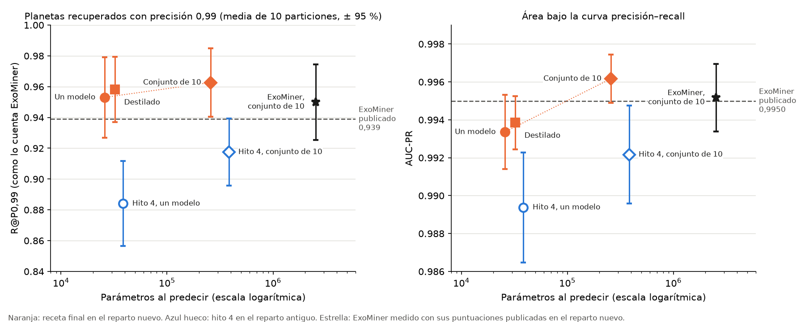

# Hito 5, paso 4 · Modelo final y veredicto frente a ExoMiner

<!-- resumen:inicio -->
**Veredicto: el conjunto de 10 modelos de bolsillo supera a ExoMiner; un modelo suelto, no.** Con la
receta, el reparto de estrellas y la regla cerrados en un commit antes de entrenar (sección 1), y un
reparto en 10 particiones que no se había usado nunca, media de las 10 particiones (R@P0,99 exacto ·
como lo cuenta ExoMiner · AUC-PR):

| | Parámetros | R@P0,99 exacto | Como ExoMiner | AUC-PR |
|---|---|---|---|---|
| *ExoMiner, conjunto de 10, publicado (sus etiquetas y particiones)* | ≈ 2,5 millones | 0,920 | 0,939 | 0,995 |
| *ExoMiner, sus puntuaciones en nuestras particiones nuevas* | ≈ 2,5 millones | 0,926 | 0,950 | 0,9952 |
| Un modelo (media de 10 semillas) | 25.745 | 0,927 | 0,953 | 0,9934 |
| Destilado del conjunto en un modelo (media de 10 semillas) | 25.745 | 0,936 | 0,958 | 0,9938 |
| **Conjunto de 10** | **257.450** | **0,950** | **0,963** | **0,9962** |

* **Conjunto contra conjunto: supera** en las tres medias, contra lo publicado (+0,030 · +0,024 ·
  +0,0012) y contra las puntuaciones de ExoMiner en las mismas partes de prueba (+0,023 ± 0,029 ·
  +0,013 ± 0,039 · +0,0010 ± 0,0018; por delante en 7, 8 y 7 de las 10 particiones), con unas 10 veces
  menos parámetros. Por la regla, supera; por estadística, la ventaja en AUC-PR está dentro del ruido
  y la de R@P0,99, en el borde.
* **Un modelo contra su conjunto de 10: no supera.** Iguala o pasa en R@P0,99 (0,927 y 0,953 frente a
  0,920 y 0,939 publicados; +0,001 y +0,003 en la directa), pero se queda en **0,9934 de AUC-PR:
  −0,0016** frente al 0,995 publicado y **−0,0018 ± 0,0017** en la directa (por delante solo en 2 de
  las 10 particiones).
* **El destilado** (un modelo de la misma receta entrenado con ½ etiqueta + ½ puntuación del conjunto)
  mejora al modelo suelto en las tres cifras (+0,009 · +0,005 · +0,0004) y tampoco supera: pasa en
  R@P0,99 (0,936 y 0,958) y se queda en 0,9938 de AUC-PR (−0,0012 frente al publicado, −0,0013 ±
  0,0017 en la directa, por delante en 4 de 10).
* **El reparto nuevo casi no mueve nada**: la misma receta daba en el paso 2 0,920 · 0,957 · 0,9935 (un
  modelo) y 0,956 · 0,969 · 0,9961 (conjunto). La ventaja del conjunto no dependía de cómo se
  agruparon las estrellas cuando se eligió la receta.
* Configuraciones nuevas en este paso: una receta y su destilado, 200 modelos, sin elegir nada. Lo que
  falta para que un modelo suelto pase en AUC-PR está en el paso 2 (planetas de estrellas saturadas y de
  periodo detectado al doble) y es el paso 3 del plan, que no se ha hecho.
<!-- resumen:fin -->

## Cómo se reproduce

```bash
uv sync
uv run python scripts/hito5_veredicto.py run      # 200 modelos (100 de la receta, 100 destilados), reanudable; horas
uv run python scripts/hito5_veredicto.py report   # las tablas de este documento, hito5_veredicto.json y hito5_calidad_coste.png
uv run python scripts/hito5_veredicto.py run --quick   # prueba de humo: 1 partición, 1 semilla, 1 época
```

`run` acepta `--shard i/n` para repartir el trabajo entre varios procesos. Todo se guarda en
`data/hito5/veredicto/` (predicciones de validación, de prueba y de todas las señales, y los pesos).
`report` necesita también las puntuaciones publicadas de ExoMiner, que baja `hito5_diagnostico`
(tablas 3 y 13 del artículo, del código fuente de arXiv, y sus particiones).

## 1. Qué se fijó antes de medir

Esta sección y `scripts/hito5_veredicto.py` se dejaron en un commit **antes de entrenar ningún modelo
con el reparto nuevo y antes de leer ninguna de sus partes de prueba**. La receta, el reparto y la
regla no se han cambiado después; solo se aclaró la redacción de la línea 82 tras entrenar, sin tocar
cifras ni regla.

* **Reparto nuevo.** `splits.star_folds(kepid, 10, seed=20261122)`: 10 particiones por estrella (todas
  las señales de una estrella en la misma), que no se habían usado nunca. Todos los pasos anteriores
  (hitos 4 y 5) usaron la semilla 0. El protocolo es el del hito 4: prueba = partición *f*,
  validación = partición *f* + 1, entrenamiento = las otras 8; el umbral de cada modelo se elige con
  su validación. Así, ni la receta ni ninguna elección del paso 2 ha visto las etiquetas de estas
  partes de prueba **agrupadas así**. Las señales son las mismas, y por eso no es una muestra nueva:
  ver sección 4.
* **Receta.** La «combinación» del paso 2 (`combo` en `scripts/hito5_receta.py`), sin tocar: ramas por
  prueba, sin vistas de impares/pares ni local, señal hermana, magnitud Kepler, vista global a P/2 y
  coincidencia de efemérides, 30 épocas, paso 2·10⁻³, suavizado de etiquetas 0,05, ruido 0,05,
  centroide con la escala del entrenamiento. **25.745 parámetros.**
* **Qué se mide**, con las semillas 0–9 en cada partición:
  * **Un modelo**: la media de las medidas de las 10 semillas en cada partición (lo que se espera de un
    modelo suelto).
  * **El conjunto de 10**: la media de las puntuaciones de las 10 semillas (257.450 parámetros).
  * **El destilado**: un modelo de la misma receta entrenado con objetivo ½ etiqueta + ½ puntuación del
    conjunto de 10 de su partición, solo con las señales de su parte de entrenamiento (el conjunto de
    cada partición no ha visto ni su validación ni su prueba). 10 semillas; se da la media de sus medidas.
    En el paso 2 el maestro era el conjunto del último peldaño; aquí es el de la receta final, para no
    entrenar 100 modelos más (fijado ahora, antes de medir).
  * Aparte, sin entrar en el veredicto: un modelo y el destilado **elegidos con la validación** entre
    sus 10 semillas.
* **ExoMiner** se mide de dos formas: (a) **lo publicado**: la media de sus 10 particiones con sus
  etiquetas y sus particiones (0,939 de R@P0,99 como lo cuenta, 0,920 con la cuenta exacta, 0,995 de
  AUC-PR; el 0,920 no está publicado: es nuestro recuento exacto de sus puntuaciones; el 0,939 y el 0,995 son los publicados, reproducidos con sus puntuaciones en el diagnóstico); (b) **directa**: sus
  puntuaciones publicadas por señal (validación cruzada propia, así que cada señal la puntúa un modelo
  que no la vio) en las **mismas partes de prueba nuevas**, con nuestras etiquetas y el mismo código
  (`hito5_diagnostico.measure`). Las 3 señales sin puntuación publicada cuentan como 0, como en el
  paso 2.
* **Regla del veredicto** (la del plan, hito 5): **«supera»** si la media de las 10 particiones es igual
  o mayor que la de ExoMiner en R@P0,99 y en AUC-PR, con menos parámetros y ≤ 50.000 por modelo,
  comparando igual con igual: el conjunto de 10 contra su conjunto de 10 y, aparte, un modelo (y el
  destilado) contra su conjunto de 10, porque ExoMiner no publica modelos sueltos.
  * Contra lo publicado: R@P0,99 contado como ExoMiner ≥ 0,939, R@P0,99 exacto ≥ 0,920 (la misma
    cuenta a los dos lados) y AUC-PR ≥ 0,995, sin redondear la nuestra.
  * Contra la medida directa: esas tres medias ≥ las de ExoMiner en las mismas partes.
  * Se dice «supera» solo si se cumplen las dos. Si falla alguna, se publican las distancias exactas y
    en qué medida falla.
* Configuraciones nuevas probadas en este paso: **una** receta (más su destilado), sin elegir nada.
  Total del hito: las 22 recetas del paso 2 y esta.

## 2. Resultado

<!-- tabla:inicio -->
Media de las 10 particiones nuevas ± intervalo del 95 % (entre paréntesis, ± intervalo del 99 %, el que usa ExoMiner). Todo con nuestras etiquetas y el mismo código de medida, salvo la primera fila, que es la cifra publicada de ExoMiner (sus etiquetas y sus particiones, medida con sus puntuaciones).

| | Parámetros al predecir | R@P0,99 exacto | R@P0,99 como lo mide ExoMiner | AUC-PR |
|---|---|---|---|---|
| *ExoMiner, conjunto de 10, publicado (sus etiquetas y particiones)* | ≈ 2,5 millones | 0,920 ± 0,023 (0,034) | 0,939 ± 0,021 (0,030) | 0,9950 ± 0,0014 (0,0020) |
| *ExoMiner, conjunto de 10, sus puntuaciones en nuestras particiones nuevas* | ≈ 2,5 millones | 0,926 ± 0,021 (0,029) | 0,950 ± 0,025 (0,035) | 0,9952 ± 0,0018 (0,0026) |
| **Un modelo** (media de las 10 semillas) | 25.745 | 0,927 ± 0,038 (0,054) | 0,953 ± 0,026 (0,038) | 0,9934 ± 0,0020 (0,0028) |
| Un modelo elegido con la validación entre 10 | 25.745 | 0,934 ± 0,043 (0,062) | 0,960 ± 0,023 (0,033) | 0,9912 ± 0,0069 (0,0099) |
| **Conjunto de 10** | 257.450 | 0,950 ± 0,026 (0,037) | 0,963 ± 0,022 (0,032) | 0,9962 ± 0,0013 (0,0018) |
| **Destilado del conjunto** (media de las 10 semillas) | 25.745 | 0,936 ± 0,029 (0,042) | 0,958 ± 0,021 (0,030) | 0,9938 ± 0,0014 (0,0020) |
| Destilado elegido con la validación entre 10 | 25.745 | 0,935 ± 0,038 (0,055) | 0,960 ± 0,020 (0,028) | 0,9946 ± 0,0019 (0,0027) |

La misma receta con las particiones de los pasos anteriores (paso 2, `docs/hito5_receta.md`), como referencia: un modelo 0,920 · 0,957 · 0,9935; conjunto de 10 0,956 · 0,969 · 0,9961; ExoMiner en aquellas particiones 0,932 · 0,950 · 0,9954.
<!-- tabla:fin -->

## 3. Veredicto

<!-- veredicto:inicio -->
«Supera» (definición del plan, hito 5): la media de las 10 particiones es igual o mayor que la de ExoMiner en R@P0,99 y en AUC-PR, con menos parámetros y ≤ 50.000 por modelo. Contra lo publicado: R@P0,99 contado como ExoMiner ≥ 0,939, R@P0,99 exacto ≥ 0,920 (la misma cuenta a los dos lados) y AUC-PR ≥ 0,995. Contra la medida directa: las mismas tres medias ≥ las de las puntuaciones publicadas de ExoMiner en las mismas partes de prueba nuevas, con nuestras etiquetas y el mismo código. Se comparan el conjunto de 10 con su conjunto de 10 y, aparte, un modelo (y el destilado) con su conjunto de 10 (ExoMiner no publica modelos sueltos).

| Comparación | Parámetros (nuestros · suyos) | Medida | Nosotros | Publicado | Distancia | Directa: ExoMiner | Distancia, partición a partición (95 %) | Particiones igual o por delante |
|---|---|---|---|---|---|---|---|---|
| Conjunto de 10 contra su conjunto de 10 | 257.450 · ≈ 2,5 millones | R@P0,99 como ExoMiner | 0,963 | 0,939 | +0,024 ✔ | 0,950 | +0,013 ± 0,039 ✔ | 8/10 |
|  |  | R@P0,99 exacto | 0,950 | 0,920 | +0,030 ✔ | 0,926 | +0,023 ± 0,029 ✔ | 7/10 |
|  |  | AUC-PR | 0,9962 | 0,9950 | +0,0012 ✔ | 0,9952 | +0,0010 ± 0,0018 ✔ | 7/10 |
| Un modelo contra su conjunto de 10 | 25.745 · ≈ 2,5 millones | R@P0,99 como ExoMiner | 0,953 | 0,939 | +0,014 ✔ | 0,950 | +0,003 ± 0,040 ✔ | 7/10 |
|  |  | R@P0,99 exacto | 0,927 | 0,920 | +0,007 ✔ | 0,926 | +0,001 ± 0,038 ✔ | 6/10 |
|  |  | AUC-PR | 0,9934 | 0,9950 | −0,0016 ✘ | 0,9952 | −0,0018 ± 0,0017 ✘ | 2/10 |
| Destilado (un modelo) contra su conjunto de 10 | 25.745 · ≈ 2,5 millones | R@P0,99 como ExoMiner | 0,958 | 0,939 | +0,019 ✔ | 0,950 | +0,008 ± 0,037 ✔ | 7/10 |
|  |  | R@P0,99 exacto | 0,936 | 0,920 | +0,016 ✔ | 0,926 | +0,010 ± 0,031 ✔ | 6/10 |
|  |  | AUC-PR | 0,9938 | 0,9950 | −0,0012 ✘ | 0,9952 | −0,0013 ± 0,0017 ✘ | 4/10 |

* Conjunto de 10 contra su conjunto de 10: **supera** a ExoMiner, contra sus cifras publicadas y contra sus puntuaciones en las mismas particiones, en las tres medias.
* Un modelo contra su conjunto de 10: **no supera** a ExoMiner (contra sus cifras publicadas, falla en AUC-PR; contra sus puntuaciones en las mismas particiones, falla en AUC-PR).
* Destilado (un modelo) contra su conjunto de 10: **no supera** a ExoMiner (contra sus cifras publicadas, falla en AUC-PR; contra sus puntuaciones en las mismas particiones, falla en AUC-PR).
<!-- veredicto:fin -->



## 4. El reparto nuevo y lo que no cambia

<!-- reparto:inicio -->
`splits.star_folds(kepid, 10, seed=20261122)`: 3.103–3.107 señales y 247–306 planetas por partición; 0 estrellas compartidas entre entrenamiento, validación y prueba en las 10 particiones. Frente al reparto de todos los pasos anteriores (semilla 0), cada parte de prueba nueva toma como mucho el 13 % de sus señales de una misma parte antigua, y el 10 % de las señales cae en la partición del mismo número (lo esperable al azar es el 10 %). ExoMiner no tiene puntuación publicada para 3 señales (0 planetas); cuentan como 0, como en el paso 2.
<!-- reparto:fin -->

* **Las señales y las etiquetas son las mismas** (31.045 señales, 2.724 planetas). Lo que cambia es qué
  estrellas comparten parte de prueba, entrenamiento y validación. Las hipótesis del diagnóstico
  salieron de mirar errores en las partes de prueba antiguas, que cubren todas las señales: esa
  información no se puede «desmirar», y por eso este paso mide sobre todo si la ventaja del paso 2
  dependía de **cómo** se agruparon las estrellas al elegir la receta.
* El paso 5 del hito (revisión por alguien que no ha hecho el trabajo) se hizo después de este informe, antes de
  publicar el repositorio; sus correcciones, de redacción, están incorporadas.
